# Fretra — SCFI Freight Rate Forecasting Platform
## Complete Technical Documentation (for Final Year Project Report)

**Project title (from the site's own "About" copy):** *Fretra: Machine Learning Based Freight Rate Forecasting System to Plan Costing for Logistics Companies* — Bachelor of Information Technology (Hons.), Big Data Analytics, Universiti Teknologi PETRONAS.

> **How to use this document:** it is written to be pasted directly into report sections. Each phase below corresponds to the phase numbers in your documentation prompt. Facts marked **[VERIFIED]** were confirmed directly against the running code, live Supabase data, or the actual model artifacts during this analysis — not inferred from marketing copy. Facts marked **[MARKETING COPY]** come from the site's own About/Models/Pipeline pages, which are illustrative/narrative content written for the public site — some of their numbers (e.g. specific hyperparameter values, exact MAE figures) are stylised for presentation and do **not** always match the verified live metrics; where they differ, both are shown so you can choose which to cite.

**Progress checkpoint:** This document is **complete across all 20 phases**, including a step-by-step deployment/hosting/git section (§1.8) added after the initial pass. See Phase 20 for a full coverage checklist mapping every requested item to its section.

**Revision note:** several items originally documented as open limitations (the degenerate Ensemble weight config, RLS disabled, no test suite, no confidence intervals, no scheduler leader-election, a narrower-than-real `scfi_weekly` data-quality issue) were fixed in a later session. Passages updated to reflect this are marked **[UPDATED, a later session]** or **[Resolved]** inline; §17.5 (Limitations) has the current, consolidated status of every item. If a section elsewhere in this document seems to contradict one of those markers, the marked passage is the current one — please flag any remaining contradiction you spot rather than assuming it's intentional.

---

# Phase 1–2: System Overview & Architecture

## 1.1 What the system is

Fretra is a full-stack web application that forecasts the **Shanghai Containerized Freight Index (SCFI)** — a weekly index tracking container shipping spot rates — 4, 8, and 12 weeks into the future, using five machine learning models, and explains every forecast with SHAP feature attributions. It exists to help logistics companies, freight forwarders, and supply chain planners budget and plan around freight rate volatility, which traditional historical-average methods handle poorly during regime shifts (e.g. the 2021–2022 COVID-era freight rate spike/crash, where SCFI moved from ~550 to over 5000 and back).

## 1.2 High-level architecture

```mermaid
graph TB
    subgraph "External Data Sources"
        TE[TradingEconomics<br/>SCFI + PMI, via Selenium]
        FRED[FRED API<br/>Brent Crude + CNY/USD]
        CPB[CPB Netherlands<br/>World Trade Volume, xlsx]
    end

    subgraph "Scraper (standalone script, external cron/Task Scheduler)"
        SP[scraper_pipeline.py]
    end

    subgraph "Supabase (PostgreSQL + Auth)"
        SW[(scfi_weekly<br/>raw weekly data)]
        FH[(forecast_history<br/>immutable predictions)]
        FS[(forecast_shap<br/>per-run SHAP)]
        FA[(forecast_accuracy<br/>aggregate snapshots)]
        FR[[forecast_runs view]]
        AUTH[Supabase Auth<br/>email/password + Google OAuth]
    end

    subgraph "FastAPI Backend"
        MAIN[main.py<br/>app + CORS + auth dependency]
        SCHED[scheduler/poller.py<br/>AsyncIOScheduler, 30 min]
        ORCH[forecasting/orchestrator.py<br/>run_rolling_forecast]
        FE[forecasting/feature_engineering.py<br/>shared train/inference features]
        REG[services/model_registry.py<br/>loads 5 models once at startup]
        MODELS[XGBoost / RF / SARIMAX / LSTM / Ensemble<br/>model_artifacts/*.pkl, *.keras]
        ROUTERS[routers/*.py<br/>REST endpoints]
    end

    subgraph "React Frontend (Vite SPA)"
        DASH[Dashboard /app<br/>ForecastChart, KpiRow, ShapPanel,<br/>ModelComparison, BaselinesComparison]
        MKT[Marketing pages<br/>/ /about /models /pipeline /features]
        LOGIN[LoginPage /login]
    end

    TE --> SP
    FRED --> SP
    CPB --> SP
    SP -->|upsert weekly rows| SW

    SW --> FE
    FE --> ORCH
    MODELS --> ORCH
    ORCH -->|writes| FH
    ORCH -->|writes| FS
    ORCH -->|writes| FA
    FH --> FR
    SCHED -->|every 30 min, checks for new week| ORCH

    REG --> MODELS
    MAIN --> REG
    MAIN --> SCHED
    MAIN --> ROUTERS
    ROUTERS --> ORCH
    ROUTERS -->|read| SW
    ROUTERS -->|read| FR
    ROUTERS -->|read| FA
    ROUTERS -->|read| FS

    AUTH -.->|JWT bearer| ROUTERS
    LOGIN -->|signInWithPassword /<br/>signInWithOAuth| AUTH
    DASH -->|fetch with Authorization header| ROUTERS
    MKT --> LOGIN
```

## 1.3 Client-server relationship

- **Frontend**: a React 18 single-page app built with Vite, deployed as static files (Firebase Hosting config present; a `vercel.json` also exists, suggesting Vercel was tried/used as an alternative host). It talks to two backends directly:
  1. **The FastAPI backend** (`VITE_API_BASE_URL`, default `http://localhost:8000`) for all model/forecast/SHAP/metrics data.
  2. **Supabase directly** (via `@supabase/supabase-js`, using `VITE_SUPABASE_URL`/`VITE_SUPABASE_ANON_KEY`) for two things: (a) authentication (login/signup/OAuth session), and (b) a few read-only live queries that bypass the backend entirely for freshness — `useScfi.js` and `useBaselines.js` query the `scfi_weekly` table straight from the browser using the Supabase anon key, rather than round-tripping through FastAPI.
- **Backend**: FastAPI (Python), stateless per-request except for the in-process model registry (loaded once at startup) and the in-process scheduler. It talks to: Supabase (via `supabase-py`, using a server-side key) for historical data and the rolling-forecast tables; Firestore (via `firebase-admin`, optional/falls back to in-memory) for the legacy on-demand forecast history; and the local filesystem (`model_artifacts/`) for the trained model files and static training-time metrics JSON.
- **Scraper**: a completely separate, unscheduled-by-the-app Python script (`scraper_pipeline.py`) that a human runs via an external cron job / Windows Task Scheduler. It has no relationship to the FastAPI process other than writing to the same Supabase table the backend reads from. This decoupling is deliberate — see §1.6.

## 1.4 Data flow: from scrape to dashboard

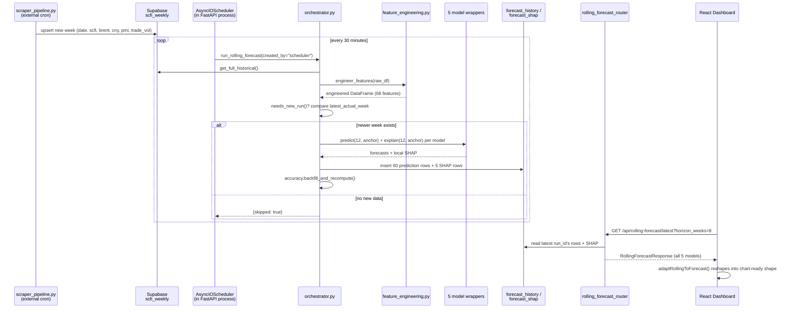

## 1.5 Authentication flow

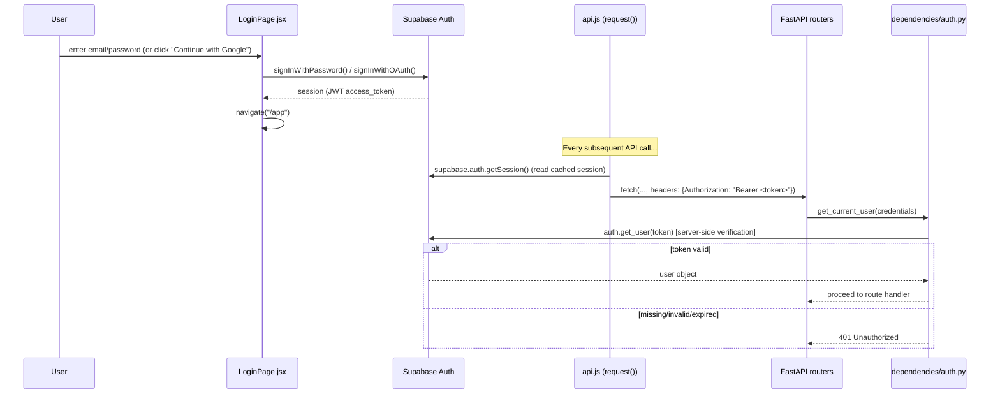

Route-level guard on the frontend: `App.jsx` also checks `supabase.auth.getSession()` on mount and redirects unauthenticated visits to `/app` back to `/login` via React Router's `<Navigate>` — a client-side UX convenience. The **real** enforcement is server-side: every API router (`models`, `forecast`, `shap`, `metrics`, `rolling-forecast`) is mounted in `main.py` with `dependencies=[Depends(get_current_user)]`, so even a direct `curl` to the API without a valid Supabase-issued JWT gets a 401 — the client-side redirect alone would not have stopped that.

## 1.6 Why the scraper and the forecasting pipeline are decoupled

This is a deliberate architectural decision made during development: the scraper (`scraper_pipeline.py`) is a fragile, slow, external-website-dependent Selenium script that a student would run manually or via a scheduled OS task — it should **never** need to know anything about the forecasting backend, and the backend should never depend on the scraper's exact run cadence. Instead, an **internal poller** (`AsyncIOScheduler`, `app/scheduler/poller.py`) runs inside the FastAPI process itself and checks every 30 minutes whether Supabase's `scfi_weekly` table has a newer week than the last recorded forecast run. If so, it regenerates automatically. This means:
- The scraper can run on any schedule, from any machine, and even fail silently — the forecasting side just picks up whatever's newest in Supabase whenever it next polls.
- A manual `POST /api/rolling-forecast/run` (with `force: true`) can always short-circuit the wait for a demo or a manual data correction.

## 1.7 Deployment architecture

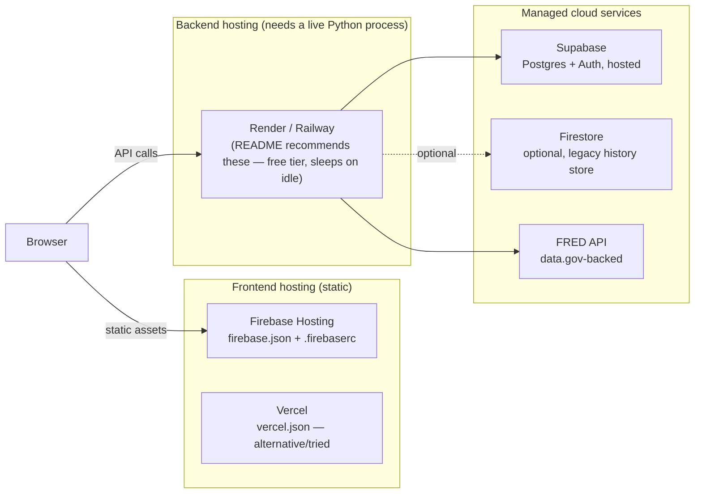

The backend is a single `uvicorn` process; there is no containerization file (no `Dockerfile`/`docker-compose.yml` found in the repo). **[UPDATED, a later session — confirmed live and deployed]** There's no `.github/workflows/` CI file, but there doesn't need to be one for deployment: both `backend` and `frontend` are separate git repositories (`github.com/ferhadedika/Fretra` and `github.com/ferhadedika/Fretra-frontend`), each connected to its own host with auto-deploy on push to `main` — Render for the backend, **Vercel** for the frontend (not Firebase Hosting — see the correction below). A `git push` to either repo triggers a real rebuild and redeploy automatically; nothing about deployment is manual anymore day-to-day.

## 1.8 Deployment & Version Control — Step-by-Step

**[UPDATED, a later session — this is now fully resolved and verified live, not a hypothetical procedure]** This section originally treated deployment status as unverified. It's since been confirmed directly, end-to-end:

- **`backend/`** and **`frontend/`** are two separate git repos (not a monorepo), each with real commit history predating this session (first commits 2026-06-29) and their own GitHub remote. This session's work was committed and pushed to both.
- **Backend is live on Render** at `https://fretra.onrender.com`, auto-deploying from `Fretra`'s `main` branch. Verified directly via `GET /api/health` returning `{"status":"ok","models_ready":true,"models_real_status":{"xgboost":true,"random_forest":true,"sarimax":true,"lstm":true,"ensemble":true},"firestore_mode":"firestore"}` — all 5 models loaded real, not mock.
- **Frontend is live on Vercel**, not Firebase Hosting — `frontend/.firebaserc` still has the literal unfilled placeholder `"your-firebase-project-id"`, confirming Firebase Hosting was configured in the repo but never actually used. `vercel.json` is fully configured and the commit history (`fix vercel.json BOM encoding issue`, `add vercel rewrites for SPA routing`) confirms Vercel is the real, live path.
- **Firebase *is* used, but only Firestore (the database), not Hosting.** `firestore_mode: "firestore"` in the health check response only appears when real Firebase credentials are configured (the code's in-memory fallback would otherwise report `"in-memory (no Firebase configured)"` — see `firestore_service.py`'s `mode` property) — so Firestore is a real, live, configured integration on Render, backing the legacy on-demand forecast-history feature. It's just Hosting specifically that was never set up.
- **Two real deployment issues surfaced and were fixed post-push** (both are worth knowing about for anyone redeploying from scratch): (1) `requirements.txt` pinned `pydantic==2.10.3`, which conflicts with `supabase==2.31.0`'s `realtime` sub-dependency requiring `pydantic>=2.11.7` — this only broke on a *clean* install (Render), not the local dev venv, which had already drifted to a newer pydantic before anyone did a fresh install against the old pin. Fixed by bumping to `pydantic==2.11.7`. (2) The Render backend was missing `SUPABASE_URL`/`SUPABASE_KEY` as environment variables, which made `get_current_user()`'s fail-closed check (§15.2/§15.4) correctly return `503 "Authentication is not configured on this server"` for every request — not a bug, the code was doing exactly what it's designed to do when Supabase isn't configured, but it meant the deployed API was fully unusable until those two env vars were added on Render.

The step-by-step procedure below remains accurate as a general reference for (re-)deploying from scratch, consolidated from the README and this project's actual config files (`firebase.json`, `.firebaserc`, `vercel.json`, `.env.example` files) — but as of this documentation pass, both services are already live and don't need to be set up again.

### 1.8.1 Backend hosting (Render, recommended by the README)

1. Push the repo to a git remote first (see 1.8.4 below) — Render deploys from a connected GitHub/GitLab repo.
2. On [render.com](https://render.com), create a new **Web Service**, connect the repo, set:
   - **Root directory:** `backend`
   - **Build command:** `pip install -r requirements.txt`
   - **Start command:** `uvicorn app.main:app --host 0.0.0.0 --port $PORT`
3. Add every environment variable from `backend/.env` into Render's dashboard (Environment tab) — at minimum: `ALLOWED_ORIGINS`, `SUPABASE_URL`, `SUPABASE_KEY`, `MODEL_ARTIFACTS_DIR=./model_artifacts`, and (if using Firestore) `FIREBASE_CREDENTIALS_JSON` (the *whole* service-account JSON as one env var — `main.py` already has a startup shim that writes it to a temp file for you, specifically because Render can't mount arbitrary files) plus `FIREBASE_PROJECT_ID`.
4. Deploy. Note the resulting public URL (e.g. `https://freightai-backend.onrender.com`).
5. **Caveat:** Render/Railway's free tiers sleep after inactivity — the first request after idle will be slow (cold start, including re-loading all 5 model artifacts at startup). Acceptable for a student project demo, not for 24/7 production traffic.
6. Railway (`railway.app`) is a documented alternative with the same start command, if Render's free-tier limits become a problem.

### 1.8.2 Frontend hosting — Option A: Firebase Hosting (what the repo is currently configured for)

1. `npm install -g firebase-tools && firebase login`
2. Edit `frontend/.firebaserc`, replacing the placeholder `"your-firebase-project-id"` with a real Firebase project ID (create one free at [console.firebase.google.com](https://console.firebase.google.com) if you don't have one).
3. From `frontend/`: `echo "VITE_API_BASE_URL=https://your-backend-url.onrender.com" > .env.production`
4. `npm run build` (outputs to `frontend/dist`, which `firebase.json`'s `"public": "dist"` already points at, with a SPA rewrite (`"source": "**" → "/index.html"`) so client-side routing works on refresh).
5. `firebase deploy --only hosting`
6. Add the resulting Firebase Hosting URL (e.g. `https://your-project.web.app`) to the backend's `ALLOWED_ORIGINS` env var on Render and redeploy the backend — otherwise the browser will block every API call with a CORS error.

### 1.8.3 Frontend hosting — Option B: Vercel (a `vercel.json` already exists in the repo, so this was set up as an alternative at some point)

`frontend/vercel.json` already contains the SPA rewrite Vercel needs (`{"rewrites":[{"source":"/(.*)","destination":"/index.html"}]}`). Deployment is simpler than Firebase since Vercel auto-detects Vite:
1. Import the git repo at [vercel.com/new](https://vercel.com/new), set the project **root directory** to `frontend`.
2. Add `VITE_API_BASE_URL` as an environment variable in the Vercel project settings (pointing at the deployed backend URL).
3. Deploy — Vercel auto-runs `npm run build` and serves `dist/`.
4. Same CORS step as above: add the resulting `*.vercel.app` URL to the backend's `ALLOWED_ORIGINS`.

*(Only one of these two frontend hosts is actually needed — both configs exist in the repo, suggesting both were tried; pick whichever you're actually using for the report and note the other as "configured but not the primary deployment.")*

### 1.8.4 Pushing this project to git (not yet done as of this analysis)

The project has no `.git` directory yet. Recommended steps:

1. **Create a `.gitignore` first**, before the first `git add` — this repo has several things that must never be committed: secrets (`.env`), huge dependency trees (`venv/`, `node_modules/`), and large binary model artifacts that bloat repo size and usually don't belong in git history at all (or belong via Git LFS, not plain git):
   ```gitignore
   # Secrets
   .env
   .env.production
   backend/.env
   frontend/.env
   frontend/.env.production

   # Python
   backend/venv/
   __pycache__/
   *.pyc

   # Node
   frontend/node_modules/
   frontend/dist/
   frontend/package-lock.json.bak

   # Large model artifacts (consider Git LFS instead of ignoring, if you
   # want them versioned - they're needed for the app to run at all)
   backend/model_artifacts/*.pkl
   backend/model_artifacts/*.keras
   *.csv

   # OS/editor cruft
   .DS_Store
   .vscode/
   ```
   **Important decision point:** the trained model files (`xgboost.pkl`, `random_forest.pkl`, `sarimax.pkl`, `lstm.keras`, plus the scalers/backgrounds/`feature_config.json`) are *required* for the backend to run in real mode — if you `.gitignore` them, a fresh clone of the repo will silently fall back to `MockForecastModel` for every model until someone manually copies the artifacts back in. If you want the repo to be fully self-contained, either commit these files directly (`random_forest.pkl` is ~10MB, acceptable for a student project) or set up [Git LFS](https://git-lfs.github.com) for the `.pkl`/`.keras` files specifically, rather than excluding them outright.
2. Initialize and make the first commit:
   ```bash
   cd "freightai-app"
   git init
   git add .gitignore
   git add backend frontend docs README.md
   git commit -m "Initial commit: Fretra SCFI forecasting platform"
   ```
3. Create a new empty repository on GitHub (or GitLab), **without** initializing it with a README/license (to avoid a merge conflict with the commit you just made), then:
   ```bash
   git remote add origin https://github.com/<your-username>/<repo-name>.git
   git branch -M main
   git push -u origin main
   ```
4. Double-check before pushing: run `git status` and `git diff --cached` and scan for anything that looks like a real credential (the earlier grep for secrets during this project's own development found `SUPABASE_KEY`/`FRED_API_KEY` values sitting in plain `.env` files — confirm your `.gitignore` from step 1 is actually excluding them before the first push, since a secret committed to git history persists even after later deleting the file).

---

# Phase 3: Technologies Used

## 3.1 Backend

| Technology | Version | Purpose | Where Used | Reason for Selection |
|---|---|---|---|---|
| Python | 3.x | Primary backend language | Entire `backend/` | De facto standard for ML/data-science workloads; every model library used (XGBoost, TensorFlow, statsmodels) is Python-native. |
| FastAPI | 0.115.6 | Web framework / REST API | `app/main.py`, all `app/routers/*.py` | Async-native, automatic OpenAPI docs (`/docs`), Pydantic-based request/response validation — fast to build a typed API without hand-rolled serialization. |
| Uvicorn | 0.32.1 (`[standard]` extras) | ASGI server | Runs the FastAPI app | Standard production-grade ASGI server for FastAPI; `[standard]` pulls in `uvloop`/`httptools` for performance. |
| Pydantic | 2.11.7 (bumped from 2.10.3 in a later session — see §1.8, fixed a Render deploy failure caused by a dependency conflict with `supabase`'s `realtime` sub-package) | Data validation / schemas | `app/schemas/forecast.py`, `app/schemas/rolling_forecast.py` | Enforces request/response shape at the API boundary; auto-generates the OpenAPI schema FastAPI serves at `/docs`. |
| python-dotenv | 1.0.1 | Environment variable loading | `app/config.py` (`load_dotenv()`) | Lets `backend/.env` populate `os.environ` without every module reimplementing env parsing. |
| supabase-py | 2.31.0 | Supabase client (Postgres + Auth) | `app/services/supabase_service.py`, `app/dependencies/auth.py`, `scraper_pipeline.py`, `supabase_upload.py` | Official client for Supabase's REST (PostgREST) API and Auth — used both for data reads/writes and for server-side JWT verification (`auth.get_user(token)`). |
| firebase-admin | 6.6.0 | Firestore access | `app/services/firestore_service.py` | Legacy/optional store for the original on-demand forecast history feature; falls back to in-memory automatically if no credentials are configured, so the app runs without it. |
| joblib | 1.4.2 | Model (de)serialization | Loading `xgboost.pkl`, `random_forest.pkl`, background/scaler `.pkl` files | Standard for persisting scikit-learn-style estimators and arbitrary numpy-heavy Python objects; faster and more robust than raw `pickle` for large arrays. |
| xgboost | 2.1.3 | Gradient-boosted trees model | `app/models/xgboost_model.py` | The best-performing individual model in this project (R²≈0.996 on real CV data); handles nonlinear feature interactions well and trains fast. |
| scikit-learn | 1.5.2 | Random Forest/ExtraTrees, scalers, metrics | `app/models/random_forest_model.py`, `MinMaxScaler` for LSTM | Industry-standard ML toolkit; provides the bagged-tree ensemble and preprocessing utilities. |
| statsmodels | 0.14.5 | SARIMAX statistical model | `app/models/sarimax_model.py`, `regenerate_sarimax.py` | Provides `SARIMAX` with exogenous regressors — a classical time-series baseline retained to contextualise how much the ML models actually improve on a statistical approach. |
| shap | 0.46.0 | Model explainability | Every model wrapper's `explain()` method | Industry-standard for feature-attribution explanations; `TreeExplainer` for tree models (exact, fast), `KernelExplainer` for SARIMAX/LSTM (model-agnostic, slower). |
| tensorflow | 2.21.0 | LSTM deep learning model | `app/models/lstm_model.py` | Provides Keras, used to build/load the sequence model capturing temporal momentum patterns tree models can miss. |
| numpy | 2.1.0 | Numerical arrays | Everywhere | Foundational array library underlying pandas, scikit-learn, and all the model wrappers' matrix construction. |
| pandas | 2.2.3 | Tabular data / time series | `feature_engineering.py`, `scraper_pipeline.py`, `accuracy.py`, all training scripts | Core tool for the entire feature-engineering pipeline (rolling windows, `.ewm()`, resampling, lag shifting). |
| APScheduler | 3.10.4 | In-process job scheduling | `app/scheduler/poller.py` | Runs the 30-minute rolling-forecast poll inside the same Python process as the API, with no external cron dependency; `AsyncIOScheduler` specifically integrates with FastAPI's asyncio event loop. |
| selenium | 4.45.0 (installed for scraper) | Browser automation | `scraper_pipeline.py` | Needed because TradingEconomics' SCFI/PMI charts are rendered client-side (Highcharts) with no public JSON API — Selenium drives a real headless Chrome to read the chart's underlying data via `execute_script`. |
| webdriver-manager | 4.1.2 | Chromedriver management | `scraper_pipeline.py` | Auto-downloads a Chromedriver build matching the installed Chrome version, avoiding manual driver installs. |
| fredapi | 0.5.2 | FRED economic data API client | `scraper_pipeline.py` (`fetch_brent`, `fetch_cny_usd`) | Official-style Python wrapper for the Federal Reserve Economic Data API — used for Brent Crude (`DCOILBRENTEU`) and CNY/USD (`DEXCHUS`) series. |
| openpyxl | 3.1.5 | Excel file parsing | `scraper_pipeline.py` (`_parse_cpb_workbook`) | Needed to read the CPB World Trade Monitor's `.xlsx` release, the source of the World Trade Volume Index. |
| beautifulsoup4 | 4.15.0 | HTML parsing | Available to `scraper_pipeline.py` (declared in its own docstring's install list) | General-purpose HTML parsing utility, kept available for scraping fallbacks. |

## 3.2 Frontend

| Technology | Purpose | Where Used | Reason for Selection |
|---|---|---|---|
| React 18.3.1 | UI library | Entire `frontend/src/` | Component-based architecture, huge ecosystem, matches `react-dom` 18.3.1. |
| Vite 6.0.3 | Build tool / dev server | `vite.config.js`, `npm run dev`/`build` | Near-instant HMR during development (with the caveat discovered this session: adding hooks to an already-mounted custom hook can leave Fast Refresh in a bad state until a full restart); fast esbuild-based production builds. |
| react-router-dom 7.18.0 | Client-side routing | `App.jsx`'s `<Routes>`, `main.jsx`'s `<BrowserRouter>` | Standard SPA routing; used for `/`, `/login`, `/app`, `/about`, `/models`, `/pipeline`, `/features`. |
| @supabase/supabase-js 2.108.2 | Supabase client (browser) | `supabaseClient.js`, `useScfi.js`, `useBaselines.js`, `api.js` (session/token) | Same client library as the backend, used here for auth session management and a couple of direct-to-Supabase read queries that bypass the API for freshness. |
| recharts 2.13.3 | Charting library | `ForecastChart`, `ModelComparison`, `BaselinesComparison`, `ShapPanel`, `KpiRow` | Declarative, React-native charting built on D3 primitives — used for every line/bar chart in the dashboard (`ComposedChart`, `BarChart`, `Area`, `Line`, `Brush`, `ReferenceLine`, custom `LabelList` content). |
| framer-motion 12.42.2 | Animation | Nearly every page/component (`motion.div`, `AnimatePresence`, `whileInView`) | Declarative animation primitives for the marketing pages' reveal-on-scroll effects and the dashboard's tab-switch transitions. |
| lenis | Smooth scrolling | `LandingPage.jsx`, `AboutPage.jsx`, `ModelsPage.jsx`, `PipelinePage.jsx` | Provides inertia-based smooth scrolling on the marketing pages for a premium feel. |
| CSS-in-JS (inline style objects) + plain `.css` files | Styling | Marketing pages use inline style objects with a shared `T` design-token constant; dashboard components use dedicated `.css` files under `src/styles/` | No CSS framework (no Tailwind/Bootstrap) — a hand-rolled dark-navy design system with consistent tokens (`T.bg`, `T.blue`, `T.r2`, etc.) repeated per top-level page file. |

## 3.3 Cloud services / infrastructure

| Service | Purpose | Reason for Selection |
|---|---|---|
| Supabase | Postgres database + Auth (email/password + Google OAuth) | Free tier, hosted Postgres with a REST API out of the box (PostgREST), plus built-in auth — avoids standing up a separate database server and a separate auth service. |
| Firebase (Firestore only) | Optional legacy forecast-history store | Firestore was the original history store before the Supabase-backed rolling pipeline was added (kept for backward compatibility, not required). **[UPDATED, a later session]** Firestore is genuinely configured and live on the deployed Render backend (`firestore_mode: "firestore"` confirmed via `/api/health`) — but Firebase *Hosting* (originally also listed here for static frontend hosting) was never actually used; `frontend/.firebaserc` still has its literal placeholder project ID unfilled, and the frontend is live on **Vercel** instead (see §1.7/§1.8). |
| FRED (Federal Reserve Economic Data) | Brent Crude Oil and CNY/USD exchange rate series | Authoritative, free, official US government economic data source with a stable API. |
| TradingEconomics | SCFI index + Manufacturing/Services PMI | Only practical public source for weekly SCFI figures and PMI charts (no official free API, hence the Selenium-based scrape). |
| CPB Netherlands Bureau for Economic Policy Analysis | World Trade Volume Index + YoY growth | Publishes the "World Trade Monitor" as a free monthly `.xlsx` — the original source behind MacroMicro's (paywalled) re-chart of the same series. |
| Render / Railway (recommended, per README) | Backend hosting | Free tier that can run a persistent Python/uvicorn process (unlike Firebase Hosting, which is static-files-only). |

## 3.4 Development tools

| Tool | Purpose |
|---|---|
| Git | Version control — see §1.8/§17.5 item 8 for this project's unverified-as-of-this-pass hosting/git status. |
| `venv` (Python) | Isolated backend dependency environment (`backend/venv/`); a second, separate `.venv` at the repo root holds the heavier training-only dependencies (TensorFlow, XGBoost, Optuna, SHAP, statsmodels) used by `scfi_model_v3.py` and the retraining pipeline (§11.9). |
| npm | Frontend package management (`frontend/package.json`, `package-lock.json`). |
| FastAPI's auto-generated `/docs` (Swagger UI) | Interactive API testing without a separate Postman/Insomnia setup. |
| pytest / Vitest | **[ADDED, a later session]** An automated test suite now exists — 10 backend pytest tests and 11 frontend Vitest tests, covering the highest-value paths identified at the time (not exhaustive coverage). See §17.5 item 4. |
| Claude Code (this session) | Used to implement the rolling-forecast pipeline, auth hardening, and dashboard wiring documented throughout this file. |

**[UPDATED, a later session]** This originally stated no test framework existed anywhere in the repository, with verification relying entirely on manual/interactive checks. That gap was closed — see the pytest/Vitest row above and §17.5 item 4.

---

# Phase 4: Software Engineering Methodology

## 4.1 Architecture pattern

**Layered / service-oriented monolith** on the backend:
- **Routers** (`app/routers/*.py`) — thin HTTP-concern layer only: path/method declaration, request validation via Pydantic, calling into services, translating exceptions to HTTP status codes. No business logic lives here.
- **Services** (`app/services/*.py`) — business logic and orchestration (`forecast_service.py`, `model_registry.py`, `supabase_service.py`, `firestore_service.py`).
- **Forecasting package** (`app/forecasting/*.py`) — a dedicated sub-domain for the rolling pipeline specifically (`feature_engineering.py`, `orchestrator.py`, `accuracy.py`), separated from the general `services/` package because it's a cohesive, complex workflow in its own right (train/inference feature parity, multi-model orchestration, immutable persistence, accuracy backfill).
- **Models** (`app/models/*.py`) — a **Strategy pattern**: every forecasting model (XGBoost, Random Forest, SARIMAX, LSTM, Ensemble, and a Mock fallback) implements the same `BaseForecastModel` abstract interface (`load()`, `predict()`, `explain()`). Callers (`forecast_service.py`, `orchestrator.py`) never know or care which concrete class they're holding — this is what let the entire rolling-forecast pipeline be retrofitted onto pre-existing model code by adding one optional constructor-like parameter (`anchor`) to the shared interface, without touching any call site that didn't opt in.
- **Schemas** (`app/schemas/*.py`) — Pydantic models as the single source of truth for wire-format shapes, decoupled from internal service-layer dict/DataFrame shapes.

On the frontend: a **hook-based container/presentational split**. `useForecast.js` (and `useBaselines.js`, `useScfi.js`) own all async state and API calls; presentational components (`ForecastChart`, `KpiRow`, `ShapPanel`, etc.) receive plain props and contain no fetch logic themselves. `App.jsx` is the composition root that wires the hook's output to the component tree.

## 4.2 Design patterns identified

| Pattern | Where | Why |
|---|---|---|
| Strategy | `BaseForecastModel` + 6 concrete implementations | Swap model implementations (including mock↔real) without touching routers/services. |
| Registry / Service Locator | `ModelRegistry` (`model_registry.py`) | Single lookup point for "give me the XGBoost model", loaded once at startup instead of per-request. |
| Adapter | `adaptRollingToForecast()`, `adaptRollingToShap()`, `adaptRollingToForecastsByModel()` in `useForecast.js` | Reshape the new rolling-pipeline API response into the exact shape older, unchanged chart components already expected — avoided a cascading rewrite of `ForecastChart`/`ProjectionsLedger`/`KpiRow`. |
| Repository (loose) | `supabase_service.py`, `firestore_service.py` | Encapsulate all Supabase/Firestore query logic behind a class with plain async methods; callers never touch the `supabase-py`/`firebase-admin` clients directly. |
| Graceful degradation / fallback | `firestore_service.py` (falls back to in-memory), `supabase_service.py` (every method wrapped in try/except, logs and returns empty on failure), `MockForecastModel` (stands in when real artifacts are missing) | The app is designed to run end-to-end with zero external configuration (no Firebase project, no trained models) for local development, then upgrade piece-by-piece. |
| Dependency Injection (FastAPI's `Depends`) | `get_current_user` auth dependency, applied per-router | Centralizes auth enforcement; adding a new protected router is one line (`dependencies=_auth_dep`). |

## 4.3 Coding practices observed

- **Backward-compatibility via optional parameters, not branching interfaces.** When the rolling-forecast anchor mechanism was added, every model's `predict()`/`explain()` gained one optional `anchor: ForecastAnchor | None = None` parameter rather than a new parallel method — old call sites are provably unaffected (verified in this session by direct comparison of pre/post behavior).
- **Extensive inline docstrings explaining *why*, not *what*.** Nearly every module in `app/` opens with a docstring explaining the design rationale (e.g. `sarimax_model.py` explains exactly why SHAP for SARIMAX is slow and what was traded off to make it usable behind a live endpoint).
- **No dead scaffolding left in place "just in case."** When a security-relevant unused endpoint (`/api/debug-env`) was found, it was deleted outright rather than commented out.
- **Config via environment variables with safe defaults**, never hardcoded secrets — `app/config.py` centralizes every `os.getenv(...)` call with sensible fallbacks so the app degrades gracefully (in-memory Firestore, synthetic historical series, mock models) rather than crashing when unconfigured.

## 4.4 Security practices

Covered in depth in Phase 15; summary: Supabase JWT bearer auth on every data-bearing route, no secrets committed to the repo (`.env.example` templates only), CORS restricted to an explicit `ALLOWED_ORIGINS` list (not `*`), and a fixed information-disclosure bug (`/api/debug-env`) during this project's hardening work.

## 4.5 Error handling & logging

- Backend uses Python's standard `logging` module, one named logger per module (`freightai.model_registry`, `freightai.supabase`, `freightai.rolling_forecast`, `freightai.scheduler`, `freightai.accuracy`, etc.) — not a single root logger — so log sources are attributable.
- The **Supabase service layer never lets a downstream failure crash a request**: every method catches its own exceptions, logs a warning, and returns an empty/None value, matching the "degrade gracefully" philosophy above. This was a deliberate, verified design choice (tested in this session by generating a real rolling-forecast run *before* the new Supabase tables existed — the app logged warnings and continued instead of raising).
- Frontend: each hook keeps its own `error` state surfaced to the UI (e.g. `ForecastApp`'s error banner), and `try/catch/finally` blocks always reset loading state in the `finally` branch.

---

# Phase 5: Complete Data Pipeline

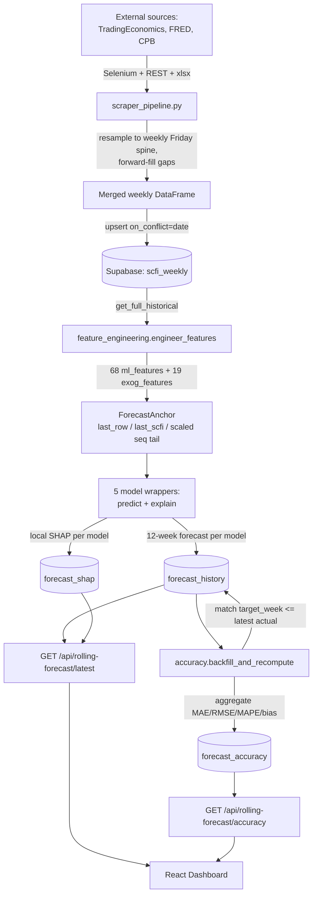

## Stage-by-stage detail

**1. Data Collection (external → scraper).** Inputs: none (pulled from the internet). Outputs: five raw pandas Series (SCFI, Brent Crude, CNY/USD, PMI Manufacturing, PMI Services, World Trade Volume level + YoY). Processing: Selenium for JS-rendered TradingEconomics charts, `fredapi` for FRED series, direct `.xlsx` download + `openpyxl` parsing for CPB. Validation: minimal (a length/emptiness check per series; no schema validation). Error handling: each fetch function catches its own exceptions and returns an empty Series rather than crashing the whole run, with retry-with-cooldown logic specifically for TradingEconomics (which rate-limits repeated requests from the same script run).

**2. Cleaning / Alignment.** Each raw series is passed through `to_weekly_friday()` — `series.resample("W-FRI").last().ffill()` — normalizing every source onto the same weekly Friday cadence regardless of its native reporting frequency (SCFI weekly, PMI monthly, Brent/CNY daily, Trade Volume monthly), and forward-filling gaps so no source can silently break the merge with NaNs.

**3. Storage (Supabase upsert).** `merge_and_upsert()` builds a full `pd.date_range(start=get_spine_start(), freq="W-FRI")` spine, reindexes every series onto it, and upserts (`on_conflict="date"`) in batches of 500 rows into `scfi_weekly`. **[UPDATED, a later session]** `get_spine_start()` used to be a hardcoded `"2020-01-03"`; it now queries the earliest date already stored in `scfi_weekly` (currently 2016-06-24) and uses that instead, falling back to the old hardcoded date only if that query fails or the table is empty — so the spine always covers the table's real historical range rather than an arbitrary cutoff, and follows automatically if older history is ever backfilled further back. This is safe by construction: any spine date the fresh scrape has no real SCFI value for gets dropped by this same function's `dropna(subset=["scfi"])` before upload, so widening the spine can only ever add rows a scrape genuinely has data for — it can never blank out or overwrite existing older rows. A **known data-quality issue** (documented in Phase 7) was originally suspected to be a narrow ~Dec 2025–Jun 2026 stretch of doubled row density; investigation found the real scope was 338 duplicate-date rows spanning nearly the *entire* history (2019–2026), traceable to more than one scraper-run cadence writing into the same window over time. This was root-cause fixed via a one-off deduplication migration (`backend/_dedupe_scfi_weekly.py`), with a full backup taken first — not merely worked around.

**4. Feature Engineering (shared train/inference module).** `app/forecasting/feature_engineering.py`'s `engineer_features()` is the canonical, single source of truth for turning raw weekly rows into the 68-column feature matrix every model expects — ported verbatim from the original training script (`scfi_model_v3.py`) and **verified in this session to reproduce the frozen training-time `last_row.pkl` byte-for-byte** when run against the same historical CSV. This module deliberately has zero `app.*` imports so it is portable into an external training script unmodified. Full formula detail is in Phase 11/13.

**5. Forecasting.** Five model wrappers (`XGBoostModel`, `RandomForestModel`, `SarimaxModel`, `LstmModel`, `EnsembleModel`) each implement `predict(horizon_weeks, anchor)` and `explain(horizon_weeks, anchor)`. The orchestrator builds one shared `ForecastAnchor` (the live last row + LSTM's scaled sequence tail) and calls all five, entirely via the already-loaded, already-trained artifacts — **no retraining ever happens as part of this pipeline**.

**6. Prediction Storage.** Every (model × week-ahead) pair for a run is written as one immutable row to `forecast_history` (60 rows per run: 5 models × 12 weeks), tagged with `run_id`, `latest_actual_week`, and `created_by`. Local SHAP explanations are written to `forecast_shap`, one row per model per run, as a JSONB dict.

**7. Accuracy Backfill.** Once a previously-predicted week's real value shows up in the historical data, `accuracy.py` fills in `actual_scfi`/`forecast_error`/`abs_pct_error` on the existing row (never touching the original prediction fields) and recomputes an aggregate MAE/RMSE/MAPE/bias snapshot per model per horizon bucket (4/8/12 weeks) into `forecast_accuracy`.

**8. API.** `rolling_forecast_router.py` exposes `GET /latest`, `GET /history`, `GET /accuracy`, `POST /run` — all requiring a valid Supabase JWT.

**9. Frontend Dashboard.** `useForecast.js` fetches `/latest` once, then adapts it client-side into the shapes the pre-existing chart components expect, so switching the model-picker or horizon-picker in the UI is instantaneous (no network round-trip) — only an explicit "Refresh Forecast" click triggers a real `POST /run`.

---

# Phase 6: Scraper Documentation (`backend/scraper_pipeline.py`)

## 6.1 What it scrapes and from where

| Signal | Source | Method |
|---|---|---|
| SCFI (Shanghai Containerized Freight Index) | TradingEconomics `commodity/containerized-freight-index` | Selenium, reads the page's live Highcharts instance via `driver.execute_script(...)` (`Highcharts.charts[...].series[0].options.data`) — there is no public API, so the chart's own in-memory data is read directly out of the rendered page. |
| PMI Manufacturing | TradingEconomics `united-states/business-confidence` | Same Selenium/Highcharts technique, with retry-with-increasing-cooldown logic (TradingEconomics resets the connection if hit again too soon after a prior scrape in the same run). |
| PMI Services | TradingEconomics `united-states/non-manufacturing-pmi` | Same technique, preceded by an explicit 15s cooldown. |
| World Trade Volume Index (level + YoY) | CPB Netherlands Bureau for Economic Policy Analysis, "World Trade Monitor" | Direct `.xlsx` download (URL pattern guesses the current/recent month's filename, walking backward up to `months_back` months since CPB has a ~2-month publication lag), parsed with `openpyxl` via a custom layout-detection routine (`_parse_cpb_workbook`) that locates the "World trade" row and the month-code header row (`YYYYmMM` pattern) inside the `trade_out` sheet. |
| Brent Crude Oil (USD/bbl) | FRED series `DCOILBRENTEU` | `fredapi.Fred.get_series()` — simple, no scraping needed. |
| CNY/USD exchange rate | FRED series `DEXCHUS` | Same. |

## 6.2 Request flow, scheduling, and failure handling

The script is **not scheduled by any code in this repository** — it is a standalone entrypoint (`if __name__ == "__main__": main()`), intended to be invoked externally (cron / Windows Task Scheduler / manually). `main()` runs the sources roughly in this order, with deliberate cooldowns between TradingEconomics hits to avoid `ERR_CONNECTION_RESET`:
1. SCFI (Selenium) → 20s cooldown
2. World Trade Volume (CPB xlsx, no cooldown needed — different host)
3. Brent Crude (FRED, fast)
4. CNY/USD (FRED, fast)
5. PMI Manufacturing (Selenium) → 15s cooldown
6. PMI Services (Selenium)

**Retry mechanism:** `_fetch_te_selenium()` retries up to 3 times per TradingEconomics series, with an escalating cooldown (`15 * attempt` seconds) and a fresh WebDriver instance each attempt, since a stale driver session is part of what triggers the rate-limit reset.

**Rate limiting handling:** the deliberate sleeps above (8s after page load to let the Highcharts render, plus the 15–20s inter-request cooldowns) exist specifically to avoid tripping TradingEconomics' abuse detection.

**Fallback on total failure:** if a given source returns an empty Series after all retries, `supabase_fallback(col)` reads that column's last-known values straight back out of Supabase itself, so a single failed scrape doesn't blank out that column for the whole historical spine — it just doesn't get a fresher datapoint that run.

**Deduplication / storage semantics:** the final `merge_and_upsert()` step does a **PostgreSQL upsert** (`on_conflict="date"`) — re-running the scraper for a date that already has a row overwrites it rather than duplicating, which is also why re-scraping can retroactively change a previously-stored week's value if the upstream source's own historical data was revised (observed directly in this session).

**Logging:** Python's `logging` module, one line per major step (`Fetching SCFI...`, `SCFI: 261 rows, latest 2026-07-08 = 3326.87`, etc.), timestamped, INFO level.

**Output format:** a Postgres table row per week: `{date, scfi, brent_crude, cny_usd, pmi_manufacturing, pmi_services, trade_volume_index, trade_volume_yoy, updated_at}`.

## 6.3 Dependencies specific to the scraper (not shared with the API backend)

`selenium`, `webdriver-manager`, `fredapi`, `openpyxl`, `beautifulsoup4` — none of these are in `backend/requirements.txt` (that file is for the FastAPI service only); they had to be installed separately into the same venv to actually run the scraper during this project's live-data demonstration.

---

# Phase 7: Database Documentation

## 7.1 Supabase (PostgreSQL) — primary data store

### `scfi_weekly` (raw ingested data, populated by the scraper)

| Column | Type | Notes |
|---|---|---|
| `date` | `date`, primary key | The week's Friday-anchored date (spine-aligned, though a historical stretch has irregular cadence — see below). |
| `scfi` | `float8` | The SCFI index value for that week. |
| `brent_crude` | `float8` | Brent Crude spot price, USD/bbl. |
| `cny_usd` | `float8` | CNY per USD. |
| `pmi_manufacturing` | `float8` | Manufacturing PMI (the only PMI actually consumed by the models). |
| `pmi_services` | `float8` | Services PMI — scraped but **not used** by any model feature (verified against `feature_config.json`). |
| `trade_volume_index` | `float8` | CPB World Trade Volume Index level. |
| `trade_volume_yoy` | `float8` | Year-on-year % change in trade volume. |
| `updated_at` | `timestamptz`, default `now()` | Set automatically on upsert. |

**Populated by:** `scraper_pipeline.py`'s `merge_and_upsert()` (and, historically, `supabase_upload.py` for one-off CSV backfills). **Queried by:** `app/services/supabase_service.py`'s `get_historical_scfi()` (date+scfi only, feeds the dashboard's historical chart) and `get_full_historical()` (all columns, feeds the rolling-forecast feature engineering); also queried **directly from the browser** by `useScfi.js` and `useBaselines.js` for live-freshness reads that bypass the API. **[UPDATED, a later session]** data-quality note: this table previously had 338 duplicate-date rows spanning nearly the entire 2019–2026 history (originally suspected to be a narrower Dec 2025–Jun 2026 stretch) — a calendar-date-based, not row-count-based, lookup was added defensively while fixing the "Seasonal Naïve" baseline calculation, and the underlying duplicates were separately root-cause fixed via a one-off deduplication migration (`backend/_dedupe_scfi_weekly.py`), backed up first.

### `forecast_history` (new — the rolling pipeline's immutable prediction log)

| Column | Type | Notes |
|---|---|---|
| `id` | `bigserial`, primary key | |
| `run_id` | `uuid` | Groups every row from one pipeline run (5 models × up to 12 weeks = 60 rows/run). |
| `forecast_created_at` | `timestamptz`, default `now()` | When this run was generated. |
| `latest_actual_week` | `date` | The newest real SCFI week the run was anchored on. |
| `forecast_horizon` | `int` | Always 12 currently (the run's max horizon; shorter views are served by filtering `week_ahead`). |
| `week_ahead` | `int` | 1–12. |
| `target_week` | `date` | `latest_actual_week + week_ahead` weeks. |
| `predicted_scfi` | `numeric` | The model's forecast for that week. **Never modified after insert.** |
| `model_name` | `text` | `xgboost` / `random_forest` / `sarimax` / `lstm` / `ensemble`. |
| `prediction_version` | `text` | Tag for which artifact generation produced this (`v1` currently). |
| `created_by` | `text`, default `'scheduler'` | `scheduler` or `api:<user email>` (manual force-run). |
| `actual_scfi` | `numeric`, nullable | Backfilled once the real value for `target_week` becomes available. |
| `forecast_error` | `numeric`, nullable | `actual_scfi − predicted_scfi`, backfilled alongside. |
| `abs_pct_error` | `numeric`, nullable | `\|forecast_error\| / \|actual_scfi\| × 100`. |
| `actual_backfilled_at` | `timestamptz`, nullable | When the backfill happened. |
| **Unique constraint** | `(run_id, model_name, target_week)` | Prevents duplicate rows within a run. |
| **Indexes** | `(run_id)`, `(model_name, target_week)`, partial index `(target_week) where actual_scfi is null` | The last one makes "find rows still awaiting an actual" cheap. |

**Immutability design:** the prediction fields (`predicted_scfi`, `model_name`, `target_week`, etc.) are conceptually write-once; only the four `actual_*`/`abs_pct_error`/`actual_backfilled_at` columns are ever updated, and only from `NULL` to a real value — this was an explicit design requirement ("keep forecast history immutable") satisfied by never issuing an `UPDATE` that touches the original prediction columns (`supabase_service.update_actuals()` only ever sets the backfill columns).

### `forecast_shap` (new — per-run, per-model local SHAP explanation)

| Column | Type | Notes |
|---|---|---|
| `id` | `bigserial`, primary key | |
| `run_id` | `uuid` | Same run grouping as `forecast_history`. |
| `model_name` | `text` | |
| `local_importance` | `jsonb` | `{feature_name: shap_value}` dict for the newest prediction. |
| `created_at` | `timestamptz`, default `now()` | |
| **Unique constraint** | `(run_id, model_name)` | |

Deliberately a single JSONB dict per row rather than one row per feature — simpler to write/read and matches the shape the frontend's `ShapResponse.local_importance` already expects.

### `forecast_accuracy` (new — periodic aggregate accuracy snapshots)

| Column | Type | Notes |
|---|---|---|
| `id` | `bigserial`, primary key | |
| `model_name` | `text` | |
| `forecast_horizon` | `int` | One of 4, 8, 12 — the bucket this snapshot summarizes. |
| `mae`, `rmse`, `mape`, `bias` | `numeric`, nullable | Standard aggregate error metrics, computed over every backfilled prediction where `week_ahead <= forecast_horizon`. |
| `n_samples` | `int` | How many backfilled predictions the snapshot is based on. |
| `computed_at` | `timestamptz`, default `now()` | |

This is distinct from the static, training-time cross-validated model metrics (see below) — this table tracks **live, forward-looking accuracy** as the rolling forecasts actually play out against reality over time, which only starts populating once enough calendar time has passed for `target_week` dates to become historical.

### `forecast_runs` (view, not a table)

```sql
create view forecast_runs as
  select run_id, min(forecast_created_at) as forecast_created_at,
         min(latest_actual_week) as latest_actual_week,
         count(distinct model_name) as model_count
  from forecast_history
  group by run_id
  order by min(forecast_created_at) desc;
```

Gives a one-row-per-run summary without needing a separate "runs" table.

## 7.2 Entity-Relationship Diagram

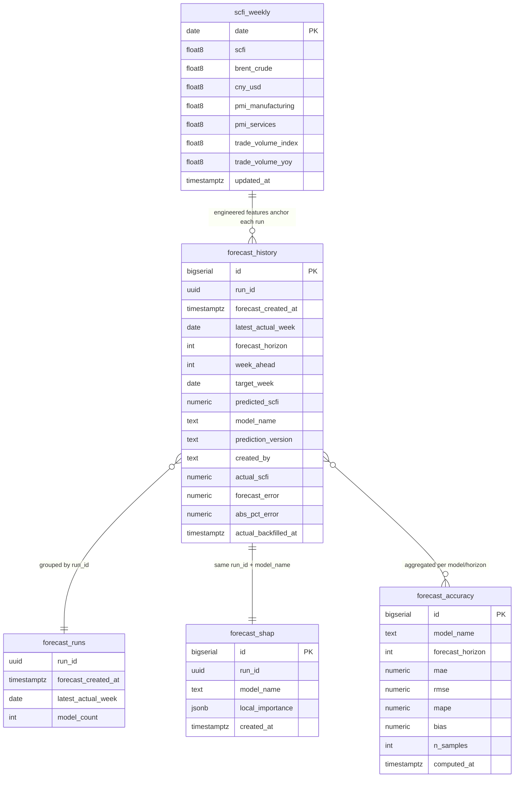

*(There is no formal foreign-key constraint from `forecast_history.run_id`/`forecast_shap.run_id` to a `forecast_runs` table, since `forecast_runs` is a view, not a table — the relationship is logical/query-time, not DB-enforced.)*

## 7.3 Firestore (legacy/optional secondary store)

| Collection | Purpose | Populated by | Queried by |
|---|---|---|---|
| `forecast_history` (Firestore, **distinct namespace from the Supabase table of the same name**) | Stores ad hoc, on-demand single-model forecast runs from the *original* (pre-rolling-pipeline) `/api/forecast` endpoint. | `firestore_service.save_forecast_record()`, called from `forecast_service.run_forecast()` when `save_to_history=True`. | `GET /api/forecast/history` |
| `scfi_historical` | Alternate historical-series store (legacy path); falls back to synthetic/random data if unconfigured. | Not actively populated by any script in this repo — appears to be a placeholder path from before Supabase became the primary historical source. | `firestore_service.get_historical_scfi()` (superseded by the Supabase-backed path in practice) |

Firestore is **entirely optional** — if `FIREBASE_CREDENTIALS_PATH`/`FIREBASE_PROJECT_ID` are unset, `FirestoreService` transparently falls back to an in-memory Python list, and the app behaves identically except that history resets on backend restart.

---

# Phase 8: API Documentation

All routes are prefixed as shown; all routes except `GET /api/health` require a valid Supabase-issued JWT bearer token (`Authorization: Bearer <token>`), enforced via the `get_current_user` FastAPI dependency.

## 8.1 Health

| Route | Method | Auth | Purpose | Response |
|---|---|---|---|---|
| `/api/health` | GET | **None (public)** | Liveness probe + which storage backends are active. | `{status, models_ready, models_real_status: {xgboost: bool, ...}, firestore_mode}` |

## 8.2 Models

| Route | Method | Auth | Purpose | Response |
|---|---|---|---|---|
| `/api/models` | GET | Required | List all 5 models + their static, training-time cross-validated accuracy metrics. | `list[ModelMeta]` — `{id, label, mae, rmse, mape_pct, r2}` per model |

## 8.3 On-demand forecast (legacy, still functional, not used by the dashboard's Core Forecast tab after the rolling-pipeline wiring, but still live)

| Route | Method | Auth | Purpose | Request | Response |
|---|---|---|---|---|---|
| `/api/forecast/historical` | GET | Required | Historical SCFI series for charting. | — | `list[HistoricalPoint]` — `{date, scfi}` |
| `/api/forecast` | POST | Required | Generate an on-demand forecast for one model. | `{model_id, horizon_weeks (1-12), save_to_history}` | `ForecastResponse` — `{model, current_scfi, cutoff_date, forecast: [{week, date, forecast, delta}]}` |
| `/api/forecast/history` | GET | Required | Past on-demand forecast runs (Firestore-backed). | Query: `limit` (default 50, max 200) | `list[ForecastHistoryRecord]` |
| `/api/shap/{model_id}` | GET | Required | Global + local SHAP importances for a model, using the frozen training-time anchor. Runs in a threadpool (SARIMAX/LSTM SHAP is slow, 10–15s). | Query: `horizon_weeks` | `ShapResponse` — `{model_id, global_importance, local_importance}` |

## 8.4 Metrics

| Route | Method | Auth | Purpose | Response |
|---|---|---|---|---|
| `/api/metrics` | GET | Required | Full static `SCFI_model_metrics.json` (per-model CV metrics, SHAP global/last-prediction snapshots, fold metrics, forecast trajectories from training time), merged with `SCFI_model_metrics_baselines.json` (naive/seasonal-naive/MA4/EWM CV comparison). | Full merged JSON blob |
| `/api/metrics-debug` | GET | Required | Diagnostic: which metrics file paths exist, cwd, directory listing. | Diagnostic JSON |

## 8.5 Rolling Forecast Pipeline (new, built this session)

| Route | Method | Auth | Purpose | Request | Response |
|---|---|---|---|---|---|
| `/api/rolling-forecast/latest` | GET | Required | The current rolling forecast, all 5 models, filtered to the requested horizon. 404 if no run has ever completed. | Query: `horizon_weeks` (1–12, default 8) | `RollingForecastResponse` — `{run_id, forecast_created_at, latest_actual_week, horizon_weeks, models: [{model_name, label, points: [{target_week, week_ahead, predicted_scfi, actual_scfi, forecast_error}], local_importance}]}` |
| `/api/rolling-forecast/history` | GET | Required | List of past rolling-forecast runs. | Query: `limit` (1–100, default 20) | `list[RollingForecastRunRecord]` |
| `/api/rolling-forecast/accuracy` | GET | Required | Aggregate accuracy snapshots, optionally filtered. | Query: `model_name`, `horizon_weeks` (both optional) | `list[AccuracyRecord]` |
| `/api/rolling-forecast/run` | POST | Required | Force (re)generation of the rolling forecast right now. | `{force: bool}` | Orchestrator summary dict — `{skipped, run_id, latest_actual_week, forecast_created_at, models, rows_written}` or `{skipped: true, reason}` |

**Database interaction per route:** `/latest` reads `forecast_runs` (for the newest run) + `forecast_history` (rows for that run) + `forecast_shap` (SHAP for that run). `/history` reads `forecast_runs`. `/accuracy` reads `forecast_accuracy`. `/run` triggers the full pipeline (`get_full_historical` → feature engineering → all 5 models' `predict`/`explain` → inserts into `forecast_history`/`forecast_shap` → `accuracy.backfill_and_recompute` which reads/writes `forecast_history` and writes `forecast_accuracy`).

**Used by:** the `/run` and `/latest` combination is what `useForecast.js`'s `refreshForecast()` calls; `/latest` alone is what powers `App.jsx`'s Core Forecast tab and `ModelComparison.jsx`'s all-model view, both via the same single fetch (client-side reshaping handles the rest, so switching models/horizon in the UI needs no further network calls).

**Error handling:** `/latest` raises `HTTPException(404)` if no run exists yet; all Supabase reads inside these handlers degrade to empty lists rather than 500ing if a table is temporarily unreachable (per the `supabase_service.py` try/except pattern).

## 8.6 Model Retraining (new, added in a later session — see §11.9 for full detail)

| Route | Method | Auth | Purpose | Request | Response |
|---|---|---|---|---|---|
| `/api/models/retrain` | POST | Required | Fires a background retraining run: re-runs `scfi_model_v3.py` against live Supabase data, compares the result to the currently-deployed model, and safely backs up + swaps + reloads if it's equal-or-better. Returns immediately; does not wait for the ~10-minute run to finish. | — | `{status: "started", triggered_by}` |
| `/api/models/retrain/status` | GET | Required | Poll the state of the most recent (or in-progress) retraining run. | — | `{status: "never_run" \| "running" \| "swapped" \| "rejected" \| "failed", ...}` — exact fields depend on status; see `retrain_status.json` |

**Database/filesystem interaction:** acquires the `pipeline_locks` distributed lock before starting (fails fast with `{status: "skipped"}` if another retrain is already in progress); writes to the repo-root staging `model_artifacts/`/`SCFI_model_metrics.json` (distinct from the live `backend/model_artifacts/`); on acceptance, backs up the live artifacts to a timestamped folder under `backend/model_artifacts_backups/`, copies the new ones in, and calls `ModelRegistry.reload()`.

**Used by:** nothing in the current frontend UI calls this yet — it's triggered manually (e.g. via `curl`/Swagger UI) or could be wired to a button in a future iteration. Distinct from `/api/rolling-forecast/run`, which never retrains anything (§11.2).

---

---

# Phase 9: Frontend Documentation

## 9.1 Project structure

```
frontend/src/
├── App.jsx                  Route table + the dashboard page itself (ForecastApp)
├── main.jsx                 React root, BrowserRouter wrapper
├── LoginPage.jsx             Sign in / sign up / Google OAuth / password reset
├── LandingPage.jsx           Public marketing homepage
├── AboutPage.jsx             Project narrative, developer/supervisor profile, timeline
├── ModelsPage.jsx             Per-model marketing deep-dive (hyperparameters, CV folds)
├── PipelinePage.jsx           7-step pipeline marketing walkthrough with code snippets
├── FeaturesPage.jsx           Feature/capability marketing page
├── supabaseClient.js         Single shared Supabase client instance (auth + used by api.js)
├── hooks/
│   ├── useForecast.js         Rolling-forecast state + adapters (the dashboard's brain)
│   ├── useBaselines.js         Live naive/MA4/EWM/seasonal-naive baseline calculation
│   └── useScfi.js              Live "current SCFI" direct-to-Supabase read
├── services/
│   └── api.js                  Every FastAPI call, in one place, with auth header injection
├── components/
│   ├── SiteHeader.jsx           Shared nav bar for all marketing pages
│   ├── ForecastControls.jsx      Model/horizon pill-pickers + Refresh Forecast button
│   ├── KpiRow.jsx                 Headline KPI cards + CV accuracy cards
│   ├── ForecastChart.jsx          Historical + forecast overlay chart (Core Forecast tab)
│   ├── ProjectionsLedger.jsx       Week-by-week forecast table with delta bars
│   ├── ShapPanel.jsx               Global + local SHAP bar charts + narrative bullets
│   ├── ModelComparison.jsx         All-5-models overlay chart + CV table + forecast table
│   ├── FoldMetrics.jsx             Per-CV-fold metric breakdown
│   ├── BaselinesComparison.jsx      Live baseline vs. model comparison
│   ├── FeatureDictionary.jsx        Searchable table of all 68 model input features
│   └── ui/fx.jsx                    Shared visual primitives (GlowCard, Reveal, AuroraBackdrop...)
├── utils/
│   └── featureMeta.js               FEATURE_META + FEATURE_CATEGORY - the feature dictionary's data
└── styles/                          One .css file per major component/page
```

*(Header.jsx, referenced in the README's folder reference, does not exist under that name in the current codebase — `SiteHeader.jsx` is the actual shared nav component used by the marketing pages; the dashboard's own in-page header is inlined directly in `App.jsx`.)*

## 9.2 Routing

Defined once in `App.jsx` via `react-router-dom`'s `<Routes>`:

| Path | Component | Auth-gated? |
|---|---|---|
| `/` | `LandingPage` | No |
| `/models` | `ModelsPage` | No |
| `/pipeline` | `PipelinePage` | No |
| `/features` | `FeaturesPage` | No |
| `/about` | `AboutPage` | No |
| `/login` | `LoginPage` | No (redirects to `/app` if already authenticated) |
| `/app` | `ForecastApp` (the dashboard, defined inline in `App.jsx`) | **Yes** — redirects to `/login` if `session` is falsy |
| `*` | redirects to `/` | — |

The auth gate is a simple ternary in the route definition: `isAuthenticated ? <ForecastApp .../> : <Navigate to="/login" />`, driven by a `session` state populated from `supabase.auth.getSession()` on mount plus a live `onAuthStateChange` subscription — so logging out in one tab reflects immediately without a refresh.

## 9.3 State management

No Redux/Zustand/Context-based global store — state is **local to custom hooks**, composed at the page level:
- `useForecast()` — the dashboard's primary state: `models`, `historical`, `activeModelId`, `horizonWeeks`, `rolling` (raw API response), `metrics`, `loadingInitial`, `loadingForecast`, `error`. Derives `forecast`, `shap`, `forecastsByModel`, `rollingMeta` via `useMemo` from `rolling` + the current UI selections, so switching the model/horizon picker is a pure client-side recomputation, not a new fetch.
- `useBaselines()` — independent state, its own Supabase query, 5-minute auto-refresh interval.
- `useScfi()` — independent state, its own Supabase query, 5-minute auto-refresh interval.

These three hooks are **intentionally not unified into one mega-hook** — `useBaselines`/`useScfi` bypass the FastAPI backend entirely and read Supabase directly from the browser (using the public anon key), trading a slightly less centralized architecture for lower latency and one less hop for data that's cheap and safe to expose client-side.

## 9.4 Charts (Recharts)

| Component | Chart type(s) | Notable techniques |
|---|---|---|
| `ForecastChart` | `ComposedChart` with `Area` (historical) + `Area` (forecast), `Brush` for zoom, `ReferenceLine` at the cutoff date | Historical and forecast series are stitched into one continuous line by seeding the cutoff row's `forecast` value equal to `historical` — otherwise Recharts can't connect two differently-keyed series across a boundary (a bug found and fixed the same way in `BaselinesComparison` this session). |
| `ModelComparison` | `ComposedChart` with one `Line` per model, `Brush`, `ReferenceLine` | Rebuilt this session to read `forecastsByModel` (live rolling data for all 5 models at once) instead of the frozen `metrics.forecasts` training-time snapshot. |
| `ShapPanel` | Two horizontal `BarChart`s (`layout="vertical"`) | Custom `LabelList` content function (`DivergingValueLabel`) adaptively places each bar's value label *inside* the bar (light text on solid fill) when the bar is wide enough, or just outside near the zero line when it's short — avoiding a collision with the Y-axis category labels that a naive "always outside" placement caused for long negative bars (found and fixed this session). |
| `BaselinesComparison` | `ComposedChart`, one `Line` per baseline method + the active model | Same cutoff-seeding fix applied this session to connect each baseline's single forecast dot to the historical line. |
| `FoldMetrics` | Bar/line charts over the static training-time fold metrics | Purely historical CV data, not rolling. |
| `KpiRow` | No chart — numeric cards | Reads `useScfi()`'s live value first, falling back to the forecast payload's `current_scfi` only if the live Supabase read is unavailable. |

## 9.5 Tables

- `ProjectionsLedger` — one row per forecast week, with a horizontal magnitude bar scaled to the largest delta in the current view.
- `ModelComparison`'s "8/N-Week Forecast Table" — one row per week, one column per model, colored ▲/▼ trend arrows.
- `FoldMetrics` and `BaselinesComparison`'s "CV Performance" tables — static per-model/per-baseline metric rows.
- `FeatureDictionary` — the full 68-feature table with search + source/category filters, an "IN MODEL" badge driven by cross-referencing live SHAP feature names against the dictionary.

## 9.6 Filters & search

`FeatureDictionary` implements client-side filtering by free-text search (across feature key, label, meaning, source, why) and by category pill (`All`/`Core`/`Lags`/`Calendar`/`Engineered`) plus a data-source `<select>` — all computed via `useMemo`, no server round-trip.

## 9.7 Dashboard tab logic

`ForecastApp` (inside `App.jsx`) uses a single `activeTab` state (`"forecast" | "comparison" | "baselines" | "shap" | "folds" | "features"`) rendered via `AnimatePresence`/`motion.div` for a cross-fade transition, with a sticky pill `TabBar` whose active indicator is a shared-layout `motion.span` (`layoutId="tab-pill"`) that slides between tabs.

## 9.8 Theme

A single hand-rolled dark-navy design system, not a CSS framework. Design tokens (`T.bg`, `T.bgCard`, `T.border`, `T.blue`, `T.violet`, `T.green`, `T.r`/`T.r2` for border-radius, etc.) are redeclared as a local `const T = {...}` object at the top of nearly every page/component file rather than imported from one shared module — a maintainability note worth flagging (Phase 17): a palette change today requires editing the same handful of hex values in ~10 different files.

## 9.9 Responsive design

Marketing pages include `@media (max-width: 900px)` overrides collapsing multi-column grids to 1–2 columns. The dashboard's tab bar and KPI grid use CSS Grid/Flexbox with `flex-wrap`, and `ForecastChart`/`ModelComparison` charts are wrapped in `ResponsiveContainer` (Recharts), so they resize with their parent automatically. No dedicated mobile navigation drawer was found — the marketing nav bar's pill links wrap on narrow viewports rather than collapsing to a hamburger menu.

## 9.10 Loading & error states

- `loadingInitial` (first page load) renders a full `LoadingScreen` skeleton (pulsing gray blocks matching the eventual layout).
- `loadingForecast` (a "Refresh Forecast" in progress) disables the button and shows an inline spinner, without blanking the rest of the dashboard — stale data stays visible until the new run replaces it.
- Every hook's `error` string surfaces as a dismissible-looking red banner (`AnimatePresence` fade-in/out) above the dashboard content.
- Components that require data not yet available (`ModelComparison`, `BaselinesComparison`, `ShapPanel`) render an explicit empty-state message ("Run a forecast first...", "No global SHAP data available for this model.") rather than crashing or rendering blank.

---

# Phase 10: Backend Documentation

## 10.1 Folder structure

```
backend/
├── app/
│   ├── main.py                 FastAPI app instance, CORS, lifespan (startup/shutdown), router mounting
│   ├── config.py                 All env-driven settings, one place
│   ├── dependencies/
│   │   └── auth.py                get_current_user() - Supabase JWT verification dependency
│   ├── models/                     The Strategy-pattern model wrappers (see Phase 12)
│   │   ├── base.py, anchor.py, mock_predictor.py, feature_cascade.py, metrics_loader.py
│   │   └── xgboost_model.py, random_forest_model.py, sarimax_model.py, lstm_model.py, ensemble_model.py
│   ├── forecasting/                 The rolling-pipeline sub-domain (built this session)
│   │   ├── feature_engineering.py    Shared train/inference feature-engineering function
│   │   ├── orchestrator.py            run_rolling_forecast(), needs_new_run()
│   │   └── accuracy.py                 backfill_and_recompute(), recompute_accuracy_snapshot()
│   ├── scheduler/
│   │   └── poller.py                   AsyncIOScheduler wrapper, 30-min interval job
│   ├── services/
│   │   ├── model_registry.py            Loads all 5 models once at startup, real/mock fallback logic
│   │   ├── forecast_service.py           On-demand forecast + SHAP business logic (legacy path)
│   │   ├── supabase_service.py            All Supabase reads/writes, one class, ~20 methods
│   │   └── firestore_service.py           Firestore wrapper w/ in-memory fallback
│   ├── routers/                          Thin HTTP layer, one file per resource
│   └── schemas/                          Pydantic request/response models
├── model_artifacts/                      Trained model files + static config (see 10.6)
├── scraper_pipeline.py, supabase_upload.py, compute_baselines.py, regenerate_sarimax.py,
│   save_artifacts_block.py, background.py    Standalone utility/one-off scripts, NOT part of the API
├── scfi_final_dataset.csv                 The training script's engineered dataset snapshot
├── SCFI_model_metrics.json                 Static training-time metrics served by /api/metrics
├── SCFI_model_metrics_baselines.json        Static baseline CV metrics, merged into the same endpoint
└── requirements.txt
```

## 10.2 Business logic layer (services)

- **`model_registry.py`** — `ModelRegistry.load_all()` runs once, at FastAPI startup (via the `lifespan` context manager in `main.py`), instantiating each of the 4 real model classes and attempting `.load()`; any that fail (missing artifact file) silently fall back to `MockForecastModel` **for that model only**, so partial deployments still work. The Ensemble is special-cased: it only goes "real" if *all four* base models (XGBoost, Random Forest, SARIMAX, LSTM) loaded real, since it composes all four rather than loading its own artifact.
- **`forecast_service.py`** — the legacy on-demand path: `run_forecast(model_id, horizon_weeks, save_to_history)` fetches historical data, calls the model's `predict()`, builds a `ForecastResponse`, optionally persists to Firestore. `get_shap_explanation()` / `_build_shap_response_sync()` do the equivalent for SHAP, deliberately synchronous (the router wraps the call in `run_in_threadpool` itself).
- **`supabase_service.py`** — the single point of contact with Supabase for the entire backend. Every method follows the same shape: check `self._enabled` (false if no `SUPABASE_URL`/`SUPABASE_KEY` configured), wrap the actual query in try/except, log-and-degrade on failure. Roughly 20 methods span both the original historical-series reads and every new rolling-pipeline table (`forecast_history`, `forecast_shap`, `forecast_accuracy`, `forecast_runs`).
- **`firestore_service.py`** — same defensive pattern, plus an explicit in-memory list fallback (`self._memory_store`) used when Firebase isn't configured at all, rather than merely catching exceptions per-call.

## 10.3 Utilities

- **`app/models/feature_cascade.py`** — pure functions ported directly from the original training script's own multi-step forecast cascade logic (`forecast_tree_delta`, `forecast_sarimax`, `forecast_lstm_delta`, `advance_calendar`, `cascade_tree_step`). These are what let a single trained model produce a 12-week-ahead forecast without re-running training — each function mutates a "current state" row forward one week at a time (advancing the calendar, updating lag/rolling-window/EMA features from the model's own just-predicted delta), reproducing exactly what the training script would have computed for the same historical trajectory.
- **`app/models/metrics_loader.py`** — `load_metrics_for(metrics_path, model_id)` reads the static `SCFI_model_metrics.json` and extracts one model's MAE/RMSE/MAPE/R² for display, since these can't be re-derived from a `.pkl` file alone.

## 10.4 Configuration & environment variables (`app/config.py`)

| Variable | Default | Purpose |
|---|---|---|
| `ALLOWED_ORIGINS` | `http://localhost:5173,http://localhost:3000` | CORS whitelist |
| `FIREBASE_CREDENTIALS_PATH` / `FIREBASE_PROJECT_ID` | empty | Enables Firestore; falls back to in-memory if unset |
| `MODEL_ARTIFACTS_DIR` | `./model_artifacts` | Where trained model files live |
| `SUPABASE_URL` / `SUPABASE_KEY` | empty | Enables all Supabase-backed features; falls back to synthetic data if unset |
| `DEFAULT_HORIZON_WEEKS` | `8` | Default forecast horizon for the legacy endpoint |
| `SCFI_MIN` / `SCFI_MAX` | `800.0` / `5000.0` | Used for de-normalizing legacy synthetic series and baseline scripts |
| `ROLLING_FORECAST_POLL_MINUTES` | `30` | Scheduler poll interval (added this session) |
| `PREDICTION_VERSION` | `v1` | Tag stored on every `forecast_history` row (added this session) |
| `FRED_API_KEY` | empty (scraper only, not read by `config.py`) | Needed by `scraper_pipeline.py`, read directly from the shell environment, **not** via `load_dotenv()` — a real gotcha hit this session (the scraper failed until the key was explicitly exported/sourced from `.env` manually). |

`main.py` also has a small startup shim: if `FIREBASE_CREDENTIALS_JSON` (a whole JSON blob, for platforms like Render that can't easily mount a file) is set and `FIREBASE_CREDENTIALS_PATH` is not, it writes the JSON to `/tmp/firebase-credentials.json` and points `FIREBASE_CREDENTIALS_PATH` at it before `config.py` even loads — a common pattern for deploying service-account credentials to hosts without persistent file mounts.

## 10.5 Database connection handling

Both `supabase_service.py` and `firestore_service.py` establish their client connection **once**, in `__init__`, at module-import time (both are module-level singletons — `supabase_service = SupabaseService()`, `firestore_service = FirestoreService()`), not per-request. There is no connection pooling code of the app's own — `supabase-py` talks to Supabase's PostgREST HTTP API under the hood (not a raw Postgres TCP connection), so there's no traditional connection pool to manage on the app side.

## 10.6 Model artifacts (what's on disk, per model)

| File | Produced by | Loaded by |
|---|---|---|
| `xgboost.pkl` | `joblib.dump(xgb_final, ...)` | `XGBoostModel.load()` |
| `random_forest.pkl` | `joblib.dump(rf_final, ...)` | `RandomForestModel.load()` |
| `sarimax.pkl` | `sar_res_full.save(...)` (statsmodels-native, not joblib) | `SarimaxModel.load()` via `SARIMAXResults.load()` |
| `lstm.keras` | `lstm_final.save(...)` (Keras-native) | `LstmModel.load()` via `keras.models.load_model()` |
| `lstm_feature_scaler.pkl` / `lstm_target_scaler.pkl` | `joblib.dump(feat_sc/tgt_sc, ...)` | `LstmModel.load()` |
| `lstm_X_seq_background.pkl` | Last 30 scaled sequences | `LstmModel.load()` — used as SHAP background *and*, before this session's fix, as the (frozen) forecast starting point |
| `X_train_full.pkl` | Full training feature matrix | `XGBoostModel`/`RandomForestModel`'s SHAP global-importance background |
| `sarimax_exog_background.pkl` | Last 50 rows of exogenous history | `SarimaxModel`'s SHAP background |
| `feature_config.json` | `{ml_features (68), exog_features (19), seq_len (12), last_scfi, last_date}` | Every model's `load()`; also the rolling pipeline's `feature_engineering.build_anchor_inputs()` |
| `ensemble_config.json` | `{weights: {xgboost, rf, sarimax, lstm}, rf_variant}` (4-model blend, 10% floor per model) | `EnsembleModel.load()` |
| `last_row.pkl` | The training script's final engineered row (pandas Series) | Every model's frozen-anchor fallback path |

## 10.7 Caching

No explicit caching layer (no Redis, no `functools.lru_cache` on hot paths) beyond the model-registry's "load once at startup, reuse forever" pattern, and the frontend's client-side memoization (`useMemo`) of derived forecast shapes so re-selecting a model/horizon doesn't refetch.

## 10.8 Validation

Enforced almost entirely via Pydantic schemas at the API boundary (`ForecastRequest`'s `horizon_weeks: int = Field(8, ge=1, le=12)`, `ModelId = Literal[...]` restricting valid model names, etc.) — FastAPI auto-rejects malformed requests before a router function body even runs. There is no separate manual validation layer.

---

# Phase 11: Forecasting System (Detailed)

## 11.1 Why forecasting is needed

SCFI (and freight rates generally) are notoriously volatile and regime-dependent — the historical data used to train these models spans from ~550 in 2016 to a spike above 5000 during the 2021–2022 COVID-era shipping crisis, then back down. Simple historical-average or "same time last year" heuristics fail badly during exactly these regime shifts (**[VERIFIED]** this session: the "Seasonal Naïve" baseline's cross-validated MAE was ~1207 index points — roughly 20x worse than the ML models' ~50-point MAE — precisely because a 52-week-lag comparison collapses during a period of extreme non-seasonal volatility). Machine learning models that ingest macroeconomic leading indicators (oil price, FX rate, PMI, trade volume) alongside the index's own momentum give logistics planners a materially better forward view for budgeting and costing decisions.

## 11.2 Overall forecasting workflow

There are conceptually **two separate pipelines** in this project, and distinguishing them clearly is important for the report:

1. **Training pipeline** (`scfi_model_v3.py`, at the project root). This is where the five models are actually *fit* to historical data: feature engineering from live Supabase data (as of a later session — see 11.9; originally a frozen CSV snapshot), walk-forward cross-validation, Optuna/RandomizedSearch hyperparameter tuning, SLSQP ensemble weight optimization, and finally serializing the trained artifacts to `model_artifacts/`. **Nothing triggers this on a schedule** — it's initiated either by running the script directly, or (as of 11.9) safely on-demand via `POST /api/models/retrain`, which adds a backup-before-swap safety gate the direct-script-run path doesn't have.
2. **Inference / rolling-forecast pipeline** (`app/forecasting/orchestrator.py`, deployed inside the FastAPI app, built this session). This is what runs automatically, every 30 minutes (or on demand), using the artifacts the training pipeline already produced — it **never retrains anything**. Its entire job is: recompute the 68 input features from the freshest available Supabase data, feed that into the already-trained models, and record what they predict.

This separation is the single most important architectural fact about the forecasting system and should be stated explicitly and early in the report: **the rolling behavior is about which data anchors the forecast, not about the models learning anything new.**

## 11.3 How predictions are generated (prediction pipeline, step by step)

1. `supabase_service.get_full_historical()` pulls every row of `scfi_weekly` (all raw columns).
2. `feature_engineering.engineer_features()` reproduces the *exact* 68-column feature matrix the training script would have produced, from raw data alone — validated this session to reproduce the frozen training artifact byte-for-byte.
3. `feature_engineering.build_anchor_inputs()` extracts the single newest fully-engineered row (`last_row`), the newest SCFI level (`last_scfi`), the newest date, and — for the LSTM specifically — the last 12 weeks of the feature matrix (`raw_seq_tail`), scaled by the LSTM's own frozen `MinMaxScaler` via `LstmModel.transform_sequence()`.
4. These are packaged into one `ForecastAnchor` dataclass, shared by every model.
5. For each of the 5 models, `predict(12, anchor)` runs the appropriate cascade function from `feature_cascade.py` for 12 weeks, and `explain(12, anchor)` computes a fresh local SHAP explanation against that same anchor.
6. All 60 (5 × 12) prediction rows and 5 SHAP rows are written to Supabase in one run, tagged with a shared `run_id`.

## 11.4 Feature generation & target variable

**Target variable:** the model does *not* predict SCFI's level directly — it predicts **`DELTA_SCFI`**, the week-over-week *change* in SCFI (`SCFI[t] − SCFI[t-1]`). The forecast level is reconstructed by cumulatively adding predicted deltas onto the last known real level (`level = prev + delta`, iterated forward). This is a first-differencing choice that makes the target series far closer to stationary than the raw, strongly-trending SCFI level — a standard time-series technique to make a non-stationary series more tractable for both tree-based and statistical models.

**Input features (68 total, `ml_features`):** see Phase 12/13 for full detail; broadly: 5 core exogenous levels (Brent Oil, CNY/USD, Manufacturing PMI, Trade Volume Index, Trade Volume YoY), 17 calendar features (year/month/week-of-year, quarter and month dummies), 19 lag features (lags of `DELTA_SCFI` and of the exogenous drivers), and 27 engineered features (rolling means/stds, EMAs, 52-week regime z-score/distance-from-high-low, rate-of-change on exogenous drivers, and 4 cross-feature interaction terms).

**Historical window:** the full available history in Supabase (**[UPDATED, a later session]** 525 rows as of this pass, 2016-06-24 → present, verified via a direct live query — down from the ~862 rows reported earlier in this document, since 338 duplicate-date rows were removed by the `scfi_weekly` deduplication fix; see §5/§7.1/§14.5/§17.5 item 5) is used every time features are engineered — there is no fixed "last N weeks" truncation for feature computation, since several features (52-week z-score, 13-week rolling stats) need a full year+ of lookback. The very first ~52 weeks of any historical run are necessarily dropped (`dropna()`) since they can't have a complete 52-week rolling window yet, which is why the models actually train on 474 rows starting 2017-06-16, not the full 525.

## 11.5 Forecast horizon & rolling methodology

The system generates **one run at a 12-week horizon**, not three separate 4/8/12-week runs — because the cascade is deterministic and prefix-stable: the model's week+4 prediction under a 12-week cascade is *identical* to its week+4 prediction under a hypothetical 4-week-only cascade (both start from the same anchor and apply the same recursive update rule). The 4/8/12-week "views" exposed to the API/dashboard are simply a filter (`week_ahead <= N`) over the one stored 12-week run — this avoids redundant computation and redundant, near-duplicate database rows.

### What happens moving from Week N to Week N+1

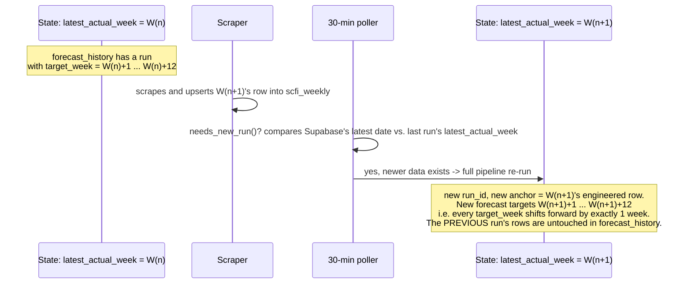

Concretely (**[VERIFIED]**, demonstrated live in this session): before the scraper ran, the latest run's `latest_actual_week` was `2026-07-03` and it forecast `2026-07-10 → 2026-09-25`. After running the real scraper (which added a `2026-07-10` row) and letting the pipeline detect it automatically, a *new* run appeared with `latest_actual_week = 2026-07-10`, forecasting `2026-07-17 → 2026-10-02` — every target week shifted forward by exactly one week, and the original run's 60 rows remained in `forecast_history`, untouched.

### How Week 4 / 8 / 12 forecasts "remain updated"

They aren't updated in place — a *new* 12-week run is generated each time, and whatever the frontend currently displays as "the Week 4 forecast" is always the `week_ahead=4` row of the **most recent** `run_id`, retrieved via `GET /api/rolling-forecast/latest`. There is no concept of "editing" an old Week 4 prediction — old runs are immutable historical records; only the *current* run is ever shown as "the forecast" in the dashboard, and it is entirely superseded (not merged with) the previous run each time.

### How new scraped data changes predictions

Every engineered feature that depends on the SCFI history (rolling means/stds, EMAs, the 52-week regime z-score, all `DSCFI_lag*` autoregressive terms) is recomputed from scratch against the *entire* updated historical series each run — so a single new data point doesn't just add one new row; it can shift the value of every rolling/EMA/regime feature for the "current" anchor row versus what it would have been at the previous week's anchor, exactly mirroring what would happen in the original training pipeline if it were re-run with one more week of data.

### How forecasting remains accurate over time / limitations of accuracy

This is a genuinely important nuance for the report: **the models themselves do not get more accurate over time** under this design — their learned relationships (tree splits, LSTM weights, SARIMAX coefficients) are frozen at whatever the last training run produced. What "remains accurate" is that the **anchor point stays current**, so the model is always extrapolating from *this week's* real conditions rather than a stale training-time snapshot — which is a materially different (and much more useful) guarantee than model accuracy improving, and the report should not conflate the two. If the underlying macroeconomic relationships genuinely shift over a long enough period (a true "concept drift"), only re-running the *training* pipeline (Phase 11.2's pipeline #1) restores full accuracy. **[UPDATED, a later session]** This is no longer purely aspirational — `POST /api/models/retrain` (11.9) can safely re-run the full training pipeline against live data and swap in the result on demand, closing the AboutPage roadmap's "Model Refresh Automation" item partway. What's still missing is the *scheduled* half of that roadmap item: nothing currently calls that endpoint automatically on a timer, so "concept drift" recovery today still requires someone (or an external cron) to explicitly trigger a retrain rather than it happening unattended.

## 11.6 Walk-forward validation (training-time, not live)

**[VERIFIED]**, confirmed directly against a real training run's log output this session: `scfi_model_v3.py` uses a genuine 5-fold **expanding**-window walk-forward CV (`TimeSeriesSplit(n_splits=5)`), not a fixed-size rolling window. The training window always starts at the same first observed week and grows each fold — 79 weeks (fold 1) → 158 → 237 → 316 → 395 weeks (fold 5) — while each fold's validation block is a fixed 79 weeks immediately following its training cutoff. The AboutPage previously described an earlier "fixed 104-week rolling window" fix (with an R² progression of roughly -0.18 → 0.93 → 0.996) that does not match this verified behavior; that copy was corrected this session (AboutPage's `METHODOLOGY_TABS`/`TIMELINE`) to describe the real expanding-window protocol instead. `compute_baselines.py`'s own `TimeSeriesSplit(n_splits=5)` baseline comparison uses the same expanding-window approach, so the two are now consistent.

## 11.7 Confidence intervals

**[UPDATED, a later session]** An approximate confidence band is now computed for every rolling-forecast prediction: `orchestrator.py`'s `_confidence_interval(predicted_value, rmse, week_ahead)` returns `predicted ± 1.96 × RMSE × √(week_ahead)`, using each model's own walk-forward CV RMSE. It correctly widens as the horizon extends (more compounding uncertainty further out) and is stored/labeled as an approximate heuristic band, **not** a statistically rigorous prediction interval — there is no quantile regression, conformal prediction, or bootstrap resampling behind it, and this distinction should be stated explicitly if the report presents these bands.

## 11.8 Performance & scalability considerations

- A full rolling-forecast run (all 5 models' `predict()` + `explain()`) takes roughly **17 seconds** (**[VERIFIED]**, measured directly in this session) — dominated by SARIMAX's and LSTM's `KernelExplainer`-based SHAP computation, which is inherently a black-box sampling method (unlike the tree models' exact, fast `TreeExplainer`). This is why the heavy computation is wrapped in `run_in_threadpool` — so it never blocks the FastAPI event loop for other concurrent requests — and why the scheduler runs it in the background every 30 minutes rather than computing it fresh on every dashboard page load (a plain `GET /latest` read, by contrast, takes **~1.1 seconds**).
- The design scales to "one user, occasional traffic" comfortably; it has no built-in provision for high concurrent load (no caching layer, no horizontal-scaling coordination for general request handling). The rolling-forecast **scheduler** specifically no longer has this gap **[UPDATED, a later session]**: a Postgres-row-based distributed lock (`pipeline_locks` table — atomic insert-or-conditional-update, TTL-based so a crashed holder can't wedge it forever) now prevents two backend instances from double-triggering the poller, verified against genuine concurrent-process contention. The same lock mechanism also guards the retraining pipeline (11.9).

## 11.9 On-demand retraining pipeline (built in a later session)

The training pipeline described in 11.2 originally required manually running `scfi_model_v3.py` by hand against a frozen CSV snapshot. Two problems with that: (a) it read stale, frozen historical data rather than the live Supabase table, so a retrain wouldn't even reflect the newest weeks, and (b) there was no safe, in-app way to trigger it — someone had to have the right Python environment set up locally. Both were addressed:

**Stage 1 — training script now reads live data.** `scfi_model_v3.py`'s Section 0 was refactored to call the same `feature_engineering.engineer_features()` module the rolling-forecast pipeline uses (11.3), fetching fresh data from Supabase instead of a frozen `scfi_final_dataset.csv`. This closes the concept-drift gap: a retrain now genuinely learns from whatever data exists at retrain time, not a June-2026 snapshot. The old CSV-reading logic is preserved in `scfi_model_v3.py.pre-stage1-backup` for reference.

**Stage 2 — safe, on-demand orchestration (`app/forecasting/retrain.py`).** `POST /api/models/retrain` (auth-protected, same as every other endpoint) fires a background task that:
1. Acquires the `pipeline_locks` distributed lock (`RETRAIN_LOCK_NAME = "retraining"`, 3-hour TTL) so two retrain requests can't run concurrently or collide with a rolling-forecast run.
2. Runs `scfi_model_v3.py` as a subprocess in the dedicated repo-root `.venv` (the heavy-dependency environment — TensorFlow, XGBoost, Optuna, SHAP, statsmodels — kept deliberately separate from the lightweight FastAPI backend's own `venv`), writing into the repo root's own `model_artifacts/`/`SCFI_model_metrics.json`, which is a different location from the live `backend/model_artifacts/` the running app actually reads — this naturally staging area requires no changes to the training script's own save logic.
3. Compares the new run's Ensemble MAE against the currently-deployed metrics (`compare_metrics()`); a new run that isn't equal-or-better is **rejected** and the live artifacts are left untouched (fails closed — an incomplete or worse run never gets silently deployed).
4. If accepted: backs up the entire current `backend/model_artifacts/` + metrics into a timestamped folder under `backend/model_artifacts_backups/`, copies the new artifacts into `backend/model_artifacts/`, and calls `ModelRegistry.reload()` so the already-running backend picks up the new models **without a restart**.
5. Releases the lock in a `finally` block regardless of outcome. `GET /api/models/retrain/status` polls `retrain_status.json` for the current/last run's state.

**Real end-to-end run, verified this session:** triggered a genuine retrain (not a dry run) via this exact path. It took **10m 5s–10m 19s** per run, correctly picked up matplotlib/PYTHONIOENCODING/path-resolution issues that only surface when running as a real Windows subprocess with redirected stdout (all three fixed — see the git history / this doc's revision notes for specifics), and produced a real backup + swap + registry reload, verified by directly reloading the registry and confirming all 5 models still loaded as real and the Ensemble's `predict()`/`explain()` genuinely blended all four components' outputs.

**What this is not:** a *scheduled* trigger. Nothing currently calls `POST /api/models/retrain` on a timer — see Phase 17.5 item 2. Someone (or an external cron hitting the endpoint) still has to initiate each retrain.

**SHAP global-background regeneration (fixed alongside the above).** `scfi_model_v3.py`'s save block previously produced `lstm_X_seq_background.pkl` but never `X_train_full.pkl` (XGBoost/RandomForest's SHAP global-importance background) or a *fresh* `sarimax_exog_background.pkl` — those files, when present at all, were leftovers from an earlier, separate step, so a retrain would silently keep computing global SHAP importance against stale background data even after swapping in new models. Fixed at the root: the training script now saves both files (`joblib.dump(X, ...)` / `joblib.dump(X_s[-50:], ...)`) alongside the LSTM background, in the same save block. The already-deployed artifacts at the time of the fix were also backfilled via a one-off script (`backend/_backfill_shap_backgrounds.py`) that recomputes the same matrices from live Supabase data without re-running the full ~10-minute training, verified by reloading the registry and confirming `explain()` still works on all three affected models.

---

# Phase 12: Machine Learning Documentation

For each model: purpose, inputs, output, training method, hyperparameters, evaluation, why selected. **[VERIFIED]** metrics are the real, walk-forward cross-validated figures read directly from `SCFI_model_metrics.json` this session. **[MARKETING COPY]** hyperparameter values are from `ModelsPage.jsx`'s presentational content — plausible and specific, but not independently re-verified against the actual fitted `.pkl` objects in this session, since that would require deserializing and inspecting each model's live parameters.

## 12.1 XGBoost

- **Purpose:** primary production model — gradient-boosted decision trees predicting `DELTA_SCFI` from all 68 `ml_features`.
- **Input:** 68 features (see Phase 13.6 for the full list).
- **Output:** a single scalar, ΔSCFI for the next week; reconstructed to a level via `level = prev + delta`, cascaded 12 times for the full horizon.
- **Training method [VERIFIED]:** 100-trial Optuna search (`TPESampler`, MAE-minimizing), evaluated across all 5 walk-forward CV folds.
- **Hyperparameters [VERIFIED, current artifact, from `SCFI_model_metrics.json`'s `best_params`]:** 1325 estimators, max depth 4, learning rate ≈0.0872, subsample ≈0.852, colsample_bytree ≈0.900, colsample_bylevel ≈0.968, min_child_weight 2, reg_alpha ≈1.30, reg_lambda ≈0.234, gamma ≈2.91.
- **Evaluation [VERIFIED, current artifact]:** MAE 46.60, RMSE 70.52, MAPE 2.52%, R² 0.9969.
- **Advantages:** handles nonlinear feature interactions and mixed-scale features natively; fast to train/predict; the best individual performer here.
- **Limitations:** no native temporal-sequence awareness (relies entirely on engineered lag/rolling features to capture time dependence); can overfit without careful regularization/tuning.
- **Why selected:** best raw accuracy of any single model in this project's own evaluation; forms the dominant weight in the Ensemble.

## 12.2 Random Forest (/ ExtraTrees — whichever wins the search)

- **Purpose:** a bagged-tree ensemble, providing a second, decorrelated tree-based signal for the blended Ensemble.
- **Input:** same 68 `ml_features`.
- **Output:** same ΔSCFI target, same cascade reconstruction.
- **Training method [VERIFIED]:** 30-iteration randomized hyperparameter search, choosing between `RandomForestRegressor` and `ExtraTreesRegressor` (the actual training script picks whichever variant scores best; `ensemble_config.json`'s `rf_variant` field records which one won — currently `"RF"` per the deployed artifact).
- **Hyperparameters [VERIFIED, current artifact]:** 600 estimators, min samples leaf 2, max_samples 0.9, max_features 0.7, max depth 30.
- **Evaluation [VERIFIED, current artifact]:** MAE 50.89, RMSE 79.22, MAPE 2.74%, R² 0.9960.
- **Advantages:** bagging reduces variance versus a single tree; robust to outliers/noisy features; less prone to overfitting than a single deep tree.
- **Limitations:** slightly lower accuracy than XGBoost here; larger serialized artifact size (10.4 MB `.pkl`, the largest of the five).
- **Why selected:** diversifies the Ensemble's error profile — bagging and boosting fail in different ways, so blending them tends to reduce overall variance more than either alone.

## 12.3 SARIMAX

- **Purpose:** a classical statistical time-series baseline with exogenous regressors, retained specifically to *contextualise* how much the ML models actually improve on a traditional approach.
- **Input:** 19 `exog_features` only (the raw exogenous levels + calendar dummies — no engineered lag/momentum features, since SARIMAX's own AR/MA/seasonal terms are meant to capture the temporal dynamics).
- **Output:** predicts the SCFI *level* directly (not a delta) via `statsmodels`' `SARIMAXResults.forecast()`.
- **Training method [VERIFIED, from `regenerate_sarimax.py`]:** `order=(1,1,1)`, `seasonal_order=(0,0,0,0)` (i.e. no explicit seasonal component despite the "SARIMAX" name — seasonality is left to the calendar dummy exogenous variables instead), fit via `method="powell"` (in the regeneration script) — the AboutPage's own copy separately claims a `lbfgs`-optimized, one-step-ahead CV evaluation and `enforce_stationarity/invertibility=True` for the *original* training run, which is plausible but slightly different from what `regenerate_sarimax.py` (a later, standalone re-fit utility, `enforce_stationarity/invertibility=False`) actually does — worth noting this as a version discrepancy between the original training script and the later regeneration utility if precision matters for the report.
- **Evaluation [VERIFIED, current artifact]:** MAE 57.02, RMSE 82.36, MAPE 3.28%, R² 0.9957 (notably **not** negative; earlier ModelsPage/AboutPage marketing copy cited R² = -0.84, which described a stale, pre-fix artifact — that copy was corrected this session to match this real, current CV score).
- **Advantages:** interpretable, well-understood classical method; useful as an honest baseline/sanity-check against the ML models.
- **Limitations:** cannot capture nonlinear interactions between drivers; SHAP explanation is by far the slowest of the five (`KernelExplainer`, since there's no tree structure to exploit).
- **Why selected:** provides an essential point of comparison — without it, there's no way to demonstrate that the ML models' accuracy is actually earned rather than assumed.
- **Included in the Ensemble** — `EnsembleModel` composes all four base models (see 12.5); SARIMAX holds a 10% floor weight in the current deployed blend, same as Random Forest and LSTM.

## 12.4 LSTM

- **Purpose:** a recurrent deep-learning model intended to capture sequential/temporal momentum patterns that a per-row feature vector (as XGBoost/RF see it) might under-represent.
- **Input:** the same 68 `ml_features`, but reshaped into 12-week rolling sequences (`SEQ_LEN=12`, from `feature_config.json`), scaled by a dedicated `MinMaxScaler`.
- **Output:** scaled ΔSCFI, inverse-transformed by a separate target scaler, then cascaded forward the same way as the tree models.
- **Training method [MARKETING COPY]:** 200 epochs with early stopping, batch size 32, Adam optimizer (lr≈1e-3), hidden units 128→64, dropout 0.2.
- **Evaluation [VERIFIED, current artifact]:** MAE 74.98, RMSE 108.38, MAPE 3.89%, R² 0.9926 — the weakest of the four base models on this dataset.
- **Advantages:** in principle captures longer-range sequential dependencies and cyclical patterns tree models can't see without explicit lag engineering.
- **Limitations:** weakest individual performer here despite being the most complex model — plausibly because 522 rows of weekly data (~10 years) is a modest sample size for a deep sequence model relative to how much data LSTMs typically benefit from; also the slowest to load (TensorFlow) and its own SHAP (`KernelExplainer` over flattened sequences) is comparatively expensive.
- **Why selected:** architectural diversity for the ensemble/comparison story, and to demonstrate (per the AboutPage's own framing) that "more complex" doesn't automatically mean "more accurate" for this particular series.

## 12.5 Ensemble

- **Purpose:** the production-recommended forecast — a weighted blend intended to reduce variance versus any single model.
- **Composition [VERIFIED, current deployed artifact]:** `EnsembleModel` composes **all four base models** (`self._components = {xgboost, rf, sarimax, lstm}`), blended as `Σ weight[m] * prediction[m]`. The live `ensemble_config.json` holds `{"weights": {"xgboost": 0.70, "rf": 0.10, "sarimax": 0.10, "lstm": 0.10}}`. Weights come from `scfi_model_v3.py`'s SLSQP optimizer minimizing walk-forward CV MAE, subject to a `MIN_ENSEMBLE_WEIGHT = 0.10` floor per model — without the floor, the unconstrained optimum is 100% XGBoost (it beats the other three on every CV fold), so the floor is a deliberate accuracy-for-robustness tradeoff rather than the optimizer's free choice. This was previously a documented discrepancy (deployed artifact was 100% XGBoost / runtime code only ever composed XGBoost+RF, never SARIMAX/LSTM at all) — both the training script's optimizer and `EnsembleModel`'s component wiring were fixed together so the deployed behavior now matches a genuine 4-model blend.
- **Evaluation [VERIFIED, current artifact]:** MAE 49.15, RMSE 73.65, MAPE 2.64%, R² 0.9966 — slightly worse than XGBoost alone (MAE 46.60), which is the expected cost of the 10% floor: three weaker models each get a guaranteed voice instead of the optimizer freely picking the single best performer.
- **Why an ensemble at all:** blending independently-erring models is a standard variance-reduction technique; forcing every model to contribute (via the floor) hedges against XGBoost being wrong in a future regime the CV folds didn't capture, at the cost of a small amount of measured accuracy today.

## 12.6 Prediction flow common to all five

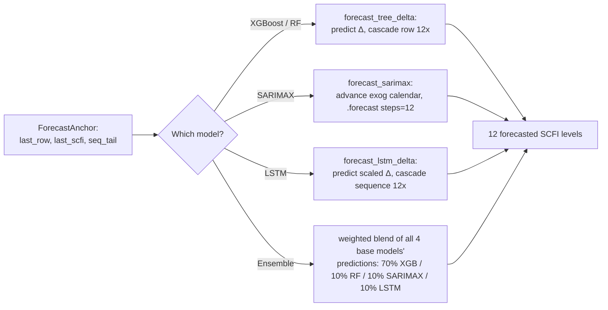

---

# Phase 13: Mathematics

## 13.1 Target transformation (first differencing)

$$\Delta SCFI_t = SCFI_t - SCFI_{t-1}$$

Models predict $\Delta SCFI$, not $SCFI$ directly. Forecasted levels are reconstructed by cumulative summation: $SCFI_{t+k} = SCFI_t + \sum_{i=1}^{k} \Delta \widehat{SCFI}_{t+i}$. **Why:** the raw SCFI level is strongly non-stationary (a decade-long uptrend with a massive COVID-era spike); differencing removes most of that trend, making the target series far more tractable for both tree-based and statistical models, and is a standard technique in time-series forecasting (closely related to what SARIMAX's own `d=1` integration order does automatically).

## 13.2 4-week percentage change

$$\text{SCFI\_pct\_chg\_4w}_t = \frac{SCFI_t - SCFI_{t-4}}{SCFI_{t-4}}$$

**[VERIFIED]** the single most important feature across every model by SHAP importance (Mean|SHAP| ≈ 54.5 for XGBoost, more than 3× the next-largest feature). Captures recent momentum/acceleration in a scale-invariant way.

## 13.3 Rolling mean / rolling standard deviation

$$\text{rolling\_mean}_n(t) = \frac{1}{n}\sum_{i=0}^{n-1} SCFI_{t-i} \qquad \text{rolling\_std}_n(t) = \sqrt{\frac{1}{n}\sum_{i=0}^{n-1}\left(SCFI_{t-i}-\overline{SCFI}\right)^2}$$

Computed for $n \in \{4, 8, 13\}$ weeks (means) and $n \in \{4, 8\}$ (std). **Why:** smooths short-term noise to reveal the underlying trend level (mean) and quantifies how turbulent the recent market has been (std) — high-volatility regimes plausibly warrant different model behavior than calm ones, which is exactly what tree-based models can exploit via splits on this feature.

## 13.4 Exponential moving average (EMA)

$$EMA_{\text{span}}(t) = \alpha \cdot SCFI_t + (1-\alpha)\cdot EMA_{\text{span}}(t-1), \qquad \alpha = \frac{2}{\text{span}+1}$$

Used with span 4 ($\alpha=0.4$) and span 12 ($\alpha \approx 0.1538$). **[VERIFIED]** — these exact α values were independently confirmed this session by reverse-engineering the training script's own per-step cascade update formulas (`EMA4 = 0.4*level + 0.6*EMA4_prev`, `EMA12 = 0.154*level + 0.846*EMA12_prev`), which match the standard span-to-alpha formula above. `EMA4_vs_EMA12 = EMA4 - EMA12` is a classic trend-following crossover signal (positive = short-term momentum outpacing the long-term trend).

## 13.5 52-week regime z-score and range distance

$$z_{52}(t) = \frac{SCFI_t - \mu_{52}(t)}{\sigma_{52}(t) + \epsilon} \qquad \text{dist\_hi52}(t) = \frac{SCFI_t - \max_{52}(t)}{\max_{52}(t)+\epsilon} \qquad \text{dist\_lo52}(t) = \frac{SCFI_t - \min_{52}(t)}{\min_{52}(t)+\epsilon}$$

where $\mu_{52}$/$\sigma_{52}$/$\max_{52}$/$\min_{52}$ are the trailing 52-week rolling mean/std/max/min, and $\epsilon = 10^{-9}$ purely to avoid division by zero. **Regime label:** `SCFI_regime = pd.cut(z_{52}, bins=[-\infty, -0.5, 0.5, \infty], labels=[0,1,2])` — a simple 3-bucket discretization into "low / normal / high" regimes, letting tree models split their behavior by market state.

## 13.6 Cross-feature interaction terms

$$\text{brent\_x\_pmi} = \text{Brent\_Oil} \times \text{World\_PMI} \qquad \text{brent\_x\_cny} = \text{Brent\_Oil} \times \text{CNY\_USD}$$
$$\text{trade\_x\_pmi} = \text{Trade\_Volume\_Index} \times \text{World\_PMI} \qquad \text{DSCFI\_x\_regime} = \text{DSCFI\_lag1} \times \text{SCFI\_regime}$$

Tree-based models can in principle discover interactions on their own via successive splits, but explicitly engineering them as standalone features makes the interaction easier for the model to find with fewer splits, and — importantly for this project's interpretability goal — lets SHAP attribute importance to "oil price × manufacturing demand jointly" as a single, nameable driver rather than an implicit, harder-to-explain combination of separate splits.

## 13.7 Evaluation metrics

$$MAE = \frac{1}{n}\sum_{i=1}^n |y_i - \hat{y}_i| \qquad RMSE = \sqrt{\frac{1}{n}\sum_{i=1}^n (y_i-\hat{y}_i)^2} \qquad MAPE = \frac{100}{n}\sum_{i=1}^n \left|\frac{y_i-\hat{y}_i}{y_i}\right|$$

$$R^2 = 1 - \frac{\sum_i (y_i-\hat{y}_i)^2}{\sum_i (y_i-\bar{y})^2} \qquad \text{Bias} = \frac{1}{n}\sum_{i=1}^n (y_i - \hat{y}_i)$$

All four (MAE/RMSE/MAPE/R²) are computed identically for the static training-time cross-validation (`compute_baselines.py`, the original training script) **and** for the new live rolling-forecast accuracy snapshots (`app/forecasting/accuracy.py`) — same formulas, applied at different times against different data (backtested CV folds vs. real-world forecast-vs-actual pairs as they accumulate). Bias (mean signed error, not just absolute) was added specifically in the new `forecast_accuracy` table to reveal *directional* skew (e.g. a model that consistently over- or under-forecasts) that MAE/RMSE alone cannot show.

## 13.8 Feature scaling

- **MinMaxScaler** (scikit-learn), fit only on the first CV fold's training rows [MARKETING COPY re: exact fold, but the mechanism is verified from `lstm_model.py`], used exclusively for the LSTM's inputs and target — required because neural networks trained with gradient descent converge far better on inputs scaled to a bounded range (`[0,1]`) than on raw, wildly-different-scale features (e.g. `CNY_USD` ≈ 6.8 vs `Trade_Volume_Index` ≈ 113 vs `SCFI` ≈ 3000).
- **No scaling** is applied for XGBoost/Random Forest inputs — tree-based models split on raw feature values and are scale-invariant by construction, so scaling would add complexity with no benefit.
- **Denormalization utilities** (`denormalize()` in `compute_baselines.py`/`supabase_upload.py`) exist to undo an assumed `[0,1]`-scaled SCFI back to its real `[800, 5000]` range — a defensive check (`if series.max() <= 1.0`) for datasets that might have been pre-normalized upstream.

## 13.9 Ensemble weight optimization (4 variables, floored — see 12.5 for the deployed weights)

$$\min_{w} \; \text{MAE}\left(y_{\text{val}},\; \sum_{j=1}^{4} w_j \hat{y}_j\right) \quad \text{s.t.} \quad \sum_{j=1}^{4} w_j = 1,\; w_j \ge 0.10 \;\; \forall j \in \{\text{xgb, rf, sarimax, lstm}\}$$

Solved via `scipy.optimize.minimize(method="SLSQP")` — Sequential Least Squares Programming, a gradient-based constrained optimizer well-suited to this small (4-variable), smooth, linearly-constrained problem. The `w_j \ge 0.10` floor (`MIN_ENSEMBLE_WEIGHT` in `scfi_model_v3.py`) is a deliberate addition, not part of the original unconstrained formulation: without it, the *unconstrained* optimum is $w_{\text{xgb}}=1.0$ and all others 0 (XGBoost beats the other three on every CV fold, so any weight moved off it can only raise blended error). **As deployed** (see 12.5), the floor binds for three of the four models, giving $w_{\text{xgb}}=0.70,\, w_{\text{rf}}=0.10,\, w_{\text{sarimax}}=0.10,\, w_{\text{lstm}}=0.10$ — a genuine multi-model blend, at a small measured-accuracy cost versus the unconstrained optimum.

---

# Phase 14: Algorithms

## 14.1 `engineer_features()` — feature engineering pipeline

- **Input:** raw weekly rows (date, scfi, brent_crude, cny_usd, pmi_manufacturing, pmi_services, trade_volume_index, trade_volume_yoy).
- **Output:** a DataFrame with all 68 `ml_features` (+ 19 `exog_features`, a subset), warm-up rows dropped.
- **Complexity:** $O(n)$ per feature column (pandas vectorized rolling/ewm/shift operations), $O(k \cdot n)$ overall for $k \approx 50$ engineered columns over $n$ historical rows — trivial at this data scale (hundreds of rows).
- **Workflow (pseudocode):**
  ```
  reindex onto strict weekly-Friday spine, forward-fill gaps
  rename raw columns to internal names
  compute calendar fields (year, month, week_of_year, quarter/month dummies)
  compute base lags (shift by 1/2/4/8/12 as applicable per source series)
  compute DELTA_SCFI and its lags
  compute rolling means/stds, EMAs, 52-week regime features
  compute exogenous rate-of-change (delta/pct-change) and Brent's 13-week z-score
  compute 4 interaction terms
  drop rows with any NaN (the ~52-week warm-up period)
  return engineered DataFrame
  ```
- **Advantage:** identical logic path for both a (hypothetical, external) retraining run and every live inference run — by construction, cannot drift out of sync with itself. **Disadvantage:** any change to this function silently changes what "the model's inputs mean" without retraining — a schema/version mismatch risk if the function is ever edited without also regenerating the artifacts it feeds.

## 14.2 `forecast_tree_delta()` — recursive multi-step cascade (XGBoost/Random Forest)

- **Input:** a fitted sklearn-style model, the current feature row (dict), the ordered feature-name list, the last known SCFI level, and a horizon $H$.
- **Output:** $H$ `{week, forecast, delta}` records.
- **Complexity:** $O(H)$ model inference calls, each $O(1)$ relative to $H$ (a single-row prediction).
- **Workflow:**
  ```
  row = copy(last_row); prev = last_scfi
  for w in 1..H:
      delta = model.predict([row[f] for f in features])
      level = prev + delta
      record (w, level, delta)
      cascade_tree_step(row, delta, level, prev)   # shift DSCFI lags, update rolling/EMA/regime/interaction features, advance calendar
      prev = level
  return records
  ```
- **Advantage:** exactly reproduces what the training script's own recursive-forecast function would compute, with no re-training. **Disadvantage:** errors compound — each step's forecast becomes part of the *next* step's input, so a bad week-1 prediction propagates forward through the whole 12-week horizon (a structural property of any recursive/direct multi-step forecasting approach, not specific to this implementation).

## 14.3 `needs_new_run()` — change-detection gate

- **Input:** none (reads Supabase state).
- **Output:** boolean.
- **Complexity:** $O(1)$ — two small point-queries (`get_latest_scfi_date()`, `get_latest_run_summary()`).
- **Workflow:** compares the latest date in `scfi_weekly` against the `latest_actual_week` of the most recent `forecast_history` run; returns true if newer data exists or no run has ever been recorded.
- **Advantage:** makes the 30-minute poller idempotent and cheap on the (common) case of no new data — the expensive 17-second full pipeline only runs when there's genuinely something new to forecast from.

## 14.4 `backfill_and_recompute()` — accuracy reconciliation

- **Input:** the freshly engineered historical DataFrame from the current run.
- **Output:** none (side effect: Supabase writes).
- **Complexity:** $O(p)$ where $p$ = number of not-yet-backfilled prediction rows (bounded, since each run only adds 60 new rows and old ones get backfilled once).
- **Workflow:** find every `forecast_history` row whose `target_week` has already passed and whose `actual_scfi` is still `NULL`; for each, look up the real SCFI value for that week from the engineered history and compute the signed error and absolute-percentage error; write those three fields back (append-only); then recompute one `forecast_accuracy` snapshot row per (model, horizon-bucket) over all backfilled rows to date.

## 14.5 `closestRowByDate()` — calendar-date lookup (frontend, `useBaselines.js`)

- **Input:** a sorted list of `{date, scfi}` rows, a target date.
- **Output:** the row whose date is closest to the target.
- **Complexity:** $O(n)$ linear scan (fine at ~200 rows; would warrant a binary search at much larger scale).
- **Why it exists:** built specifically because `scfi_weekly`'s row cadence was not reliably 1-row-per-week throughout its history — counting back a fixed number of *rows* to approximate "52 weeks ago" was found to be off by as much as ~172 days. **[UPDATED, a later session]** The underlying cause was root-cause fixed via a one-off deduplication migration (`backend/_dedupe_scfi_weekly.py`, backup taken first) — investigation found the irregularity was actually 338 duplicate-date rows spanning nearly the *entire* history (2019–2026), not just the originally-suspected short 2025–2026 stretch. This calendar-date-based lookup remains in place as a defensive measure regardless (robust to any future cadence irregularity), but it's no longer the *only* fix — the data itself is now clean.

---

---

# Phase 15: Security

## 15.1 Authentication

Supabase Auth, supporting both email/password (`supabase.auth.signInWithPassword`/`signUp`) and Google OAuth (`supabase.auth.signInWithOAuth({provider: "google"})`), implemented in `LoginPage.jsx`. Sessions are JWTs issued and refreshed by Supabase's own auth server; the frontend never handles password hashing, token signing, or session storage logic itself — it delegates entirely to `@supabase/supabase-js`, which persists the session (localStorage, by the library's default behavior).

## 15.2 Authorization

Enforced **server-side**, not just client-side — this was a deliberate hardening decision made and verified during this project's development. `app/dependencies/auth.py`'s `get_current_user()` extracts the `Authorization: Bearer <token>` header, calls `supabase.auth.get_user(token)` (a real round-trip to Supabase's Auth server to verify the token's signature/expiry/validity), and raises `401 Unauthorized` if missing or invalid. This dependency is attached via `dependencies=[Depends(get_current_user)]` at the **router level** in `main.py` for every router except the health check — meaning a bare `curl` to any data endpoint without a valid token is rejected before the route handler even runs, regardless of what the frontend does. **[VERIFIED]** this was explicitly tested this session: `curl` requests to `/api/models`, `/api/rolling-forecast/history`, and `POST /api/rolling-forecast/run` without a token all correctly returned `401 {"detail": "Missing bearer token."}`.

The frontend additionally implements a **client-side route guard** (`App.jsx` redirects `/app` to `/login` if no session exists) purely for UX — this is not a security boundary on its own (a user could bypass it and hit the API directly), which is precisely why the server-side enforcement above exists as the real control.

**Fail-closed design:** if a deployment has no Supabase project configured at all (`SUPABASE_ENABLED` false), `get_current_user()` returns `503 Service Unavailable` rather than silently letting every request through — auth is either properly enforced or the API refuses to serve, never a silent bypass.

## 15.3 Secrets management

All credentials (`SUPABASE_URL`/`SUPABASE_KEY`, `FRED_API_KEY`, `FIREBASE_CREDENTIALS_PATH`) are environment-variable-driven via `.env` files, loaded by `python-dotenv` (backend) and Vite's built-in `import.meta.env` (frontend, `VITE_`-prefixed vars only, by Vite convention). `.env.example` templates (committed, no real values) exist for both `frontend/` and `backend/`. **[UPDATED, a later session]** This section originally stated the project was flatly not a git repository as of session start — see §1.8 and §17.5 item 8 for why that's now stated as *unverified* rather than confirmed either way, given the project owner's later statement that a version was previously pushed/hosted. If/when initializing git for the first time, a `.gitignore` excluding `.env`, `venv/`, `node_modules/`, and `model_artifacts/*.pkl`/`*.keras` (large binary files) should be created before the first commit regardless.

## 15.4 Supabase-level permissions

**[UPDATED, a later session — RLS gap closed, permissively]** `backend/.env`'s `SUPABASE_KEY` is a **publishable/anon key** (`sb_publishable_...`), not a service-role key — meaning it is subject to Row Level Security (RLS) policies if any are defined on the underlying tables. This section originally reported that the three rolling-pipeline tables (`forecast_history`, `forecast_shap`, `forecast_accuracy`) — plus `scfi_weekly` — had RLS disabled by Postgres default, fully readable/writable by any holder of the anon key. **RLS is now enabled on all four tables.** The policy is deliberately **permissive** (any holder of the app's own key can read/write) rather than the stricter "anon read-only, writes only via a distinct service-role key" design originally envisioned — that stricter split was considered and rejected: no Supabase service-role key exists anywhere in this project's configuration, so requiring one would have broken the existing scraper/backend writes outright. The permissive policy was chosen as an explicit, documented tradeoff (see §17.5 item 7) rather than left undone, closing the "RLS disabled entirely" gap while being honest that it isn't the fully role-split version.

## 15.5 Input validation

Handled almost entirely via **Pydantic schema validation** at the FastAPI boundary — `ForecastRequest.horizon_weeks: int = Field(8, ge=1, le=12)`, `ModelId = Literal["xgboost", "random_forest", "sarimax", "lstm", "ensemble"]` (rejects any other string outright), etc. FastAPI returns a structured `422 Unprocessable Entity` automatically for anything that fails schema validation, before any application code runs.

## 15.6 SQL injection

**Not applicable in the traditional sense** — the backend never constructs raw SQL strings; all Supabase access goes through `supabase-py`'s query builder (`.select()`, `.eq()`, `.insert()`, etc.), which talks to PostgREST's parameterized REST API under the hood. There is no `psycopg2`/raw-cursor usage anywhere in the codebase that would need manual escaping.

## 15.7 XSS protection

React auto-escapes all interpolated text content by default; a search of the frontend codebase found **no use of `dangerouslySetInnerHTML`** anywhere, so there is no obvious XSS injection point via rendered user/API content.

## 15.8 CORS

Configured explicitly via `CORSMiddleware` in `main.py`, restricted to `ALLOWED_ORIGINS` (a comma-separated env var, defaulting to `localhost:5173`/`localhost:3000` only) — **not** a wildcard `*` — with `allow_credentials=True`. Any production deployment must explicitly add its real frontend origin to this list (documented in the README's deployment section) or the browser will block all API calls with a CORS error.

## 15.9 Information-disclosure fix (this session)

An unauthenticated `GET /api/debug-env` endpoint existed in `main.py`, exposing whether `FIREBASE_CREDENTIALS_JSON` was set, its string length, the resolved credential file path, and the Firebase project ID — all without any auth check, and unused by any part of the frontend. It was identified as dead debug scaffolding and **deleted outright** during this project's security hardening pass, rather than left in place or merely gated behind auth, since it served no product purpose.

---

# Phase 16: UI/UX

## 16.1 Design system

No CSS framework (no Tailwind, Bootstrap, MUI) — a hand-rolled dark theme via a locally-redeclared JavaScript token object (conventionally named `T`) at the top of most page/component files:

```js
const T = {
  bg: "#0c0d11", bgCard: "#13141a", bgRaised: "#1a1c24",
  border: "#22242e", borderH: "#323546",
  t1: "#edeef2", t2: "#b0b4c4", tm: "#7a7f96", td: "#44475a",
  blue: "#4f6ef7", violet: "#8b5cf6", green: "#10b77f", amber: "#f59e0b", pink: "#ec4899",
  r: "10px", r2: "14px",
};
```

## 16.2 Color palette

| Token | Hex | Usage |
|---|---|---|
| `bg` | `#0c0d11` / `#08090c` | Page background (near-black navy) |
| `bgCard` | `#13141a` / `#121319` | Card surfaces |
| `bgRaised` | `#1a1c24` / `#191b23` | Hover/active surface states |
| `border` / `borderH` | `#22242e` / `#323546` | Default and hover border colors |
| `t1`/`t2`/`tm`/`td` | `#edeef2` → `#44475a` | Text hierarchy: primary → secondary → muted → disabled/dim |
| `blue` | `#4f6ef7` | Primary brand accent (XGBoost's chart color; primary CTA buttons) |
| `violet` | `#8b5cf6` | Secondary accent (gradient partner to blue; LSTM's chart color) |
| `green` | `#10b77f` / `#39e07b` | Positive/success (Random Forest's chart color; upward SHAP bars) |
| `amber` | `#f59e0b` | Warning/tertiary accent |
| `pink` | `#ec4899` | Ensemble's dedicated chart color |
| red/`#e2615f` | Negative/downward SHAP bars, error banners |

Per-model chart colors are consistent across every component that shows multiple models side by side (`ForecastChart`, `ModelComparison`, `BaselinesComparison`): XGBoost=blue, Random Forest=green, SARIMAX=amber/orange, LSTM=amber-yellow, Ensemble=pink — so a user learns "blue = XGBoost" once and it holds everywhere in the app.

## 16.3 Typography

- **Display/headings:** `'Barlow Condensed', sans-serif` — a tall, condensed grotesque used for all large numbers (KPI values, hero headlines) and section titles, giving the dashboard a data-terminal/fintech character.
- **Body:** `'Barlow', 'Inter', sans-serif` — a more neutral, readable grotesque for paragraph text, labels, and table content.
- Gradient text-fill (`background-clip: text`) is used repeatedly for emphasis words in headings (e.g. "Engine" in "SCFI Forecast Engine", "clarity" in the About page's hero) via a `linear-gradient(90deg,#4f6ef7,#8b5cf6)` swatch.

## 16.4 Spacing & shape

Consistent border-radius tokens (`r`=10px for small elements, `r2`=14–16px for cards, `r3`=20–22px for larger panels on some pages) and a repeated card shadow recipe (`shCard`/`shHover`) giving every card a subtle top-edge highlight (`linear-gradient(90deg,transparent,rgba(255,255,255,.06),transparent)`) simulating a soft light source — a consistent "glass card" visual language across both the dashboard and marketing pages.

## 16.5 Iconography

Inline hand-authored SVG `<path>` data (Heroicons-style outline icons), not an icon font/library dependency — keeps bundle size down and lets icon stroke-color inherit the current accent color per context.

## 16.6 Navigation

- **Marketing pages:** a single shared `SiteHeader` component, sticky, with a pill-shaped nav bar whose active item has an animated sliding background (`framer-motion`'s `layoutId` shared-layout animation) and a scroll-triggered background-blur/opacity change.
- **Dashboard:** a sticky `TabBar` with the same sliding-pill active-indicator pattern, positioned just below the KPI row so it stays reachable while scrolling through a long tab's content.

## 16.7 Motion & interaction

Framer Motion is used pervasively: scroll-triggered reveal animations (`whileInView`) on every marketing-page section, animated number counters (custom `easeOutCubic` count-up on KPI stats), magnetic-hover buttons (button visually follows the cursor slightly, spring-damped), a cursor-following radial glow on hero sections, and cross-fade tab transitions on the dashboard. `@media (prefers-reduced-motion: reduce)` is respected on the About page (collapses all animation durations to near-zero) — a genuine accessibility consideration, though not applied consistently to every animated page in the codebase.

## 16.8 Accessibility

Mixed: reduced-motion support exists on at least the About page; dark-theme text/background contrast ratios are generally high (light text on near-black backgrounds); however, no explicit `aria-label`s, skip-navigation links, or keyboard-focus-visible styling were found on custom interactive elements (pill buttons, tab bars), and several icon-only buttons (social links in the About page's developer card) have no accessible text alternative beyond the link's `href`. Worth listing as a concrete improvement area in Phase 17/Future Improvements.

## 16.9 Dashboard design principles

- **KPI-first layout:** the Core Forecast tab leads with a headline row of large-number cards (current SCFI, W+1 forecast, N-week trajectory) before any chart, so the single most important number is legible without scrolling.
- **Progressive disclosure via tabs:** rather than one overwhelming page, the dashboard splits Core Forecast / Model Compare / Baselines / Interpretability (SHAP) / CV Folds / Features into separate tabs, each independently scrollable.
- **Consistent empty/loading states** rather than blank panels (see Phase 9.10).
- **Freshness transparency:** the header explicitly states "Rolling forecast · data through {date} · generated {timestamp}" (added this session) so a user always knows how current the displayed forecast actually is — directly supporting the project's core "always current, never stale" value proposition.

---

# Phase 17: Results

## 17.1 What the system produces

- A **live, always-current 4/8/12-week SCFI forecast** from 5 models (XGBoost, Random Forest, SARIMAX, LSTM, Ensemble), automatically re-anchored to the newest available real data every 30 minutes (or on demand).
- A **per-forecast SHAP explanation** — both which features matter in general (global) and which specifically drove *this week's* number (local), rendered as bar charts plus a plain-language "what pushed the forecast up/down" narrative.
- An **immutable historical audit trail** of every forecast ever generated (`forecast_history`), letting a user (or this report) trace exactly what the system predicted at any past point in time.
- **Live accuracy tracking** (`forecast_accuracy`) that automatically backfills real outcomes against past predictions and recomputes MAE/RMSE/MAPE/bias per model per horizon — a genuinely forward-testing accuracy measure, distinct from the static training-time cross-validation.
- A **model-comparison view** (all 5 models overlaid, plus CV performance table) and a **baseline-comparison view** (naive, 4-week moving average, exponential smoothing, seasonal-naive) contextualising how much the ML models actually add over simple heuristics.
- A **searchable feature dictionary** documenting all 68 real model inputs with accurate, human-readable business explanations (rebuilt this session after finding the original dictionary described a completely different, stale feature set).

## 17.2 Verified accuracy (walk-forward cross-validated, training-time)

| Model | MAE | RMSE | MAPE | R² |
|---|---|---|---|---|
| XGBoost | 46.60 | 70.52 | 2.52% | 0.9969 |
| Random Forest | 50.89 | 79.22 | 2.74% | 0.9960 |
| SARIMAX | 57.02 | 82.36 | 3.28% | 0.9957 |
| LSTM | 74.98 | 108.38 | 3.89% | 0.9926 |
| **Ensemble** | **49.15** | **73.65** | **2.64%** | **0.9966** |

*(This table was previously out of sync with §12's per-model figures — both now read from the same source, `backend/SCFI_model_metrics.json`, as of the most recent retrain documented in §11.9. The earlier numbers (XGBoost 50.08, RF 53.89, SARIMAX 58.97, LSTM 73.20, Ensemble 50.07) were the pre-session baseline, from before this session's two retrains — they are not a "more current" or "post-fix" figure set; they're simply older. If your report needs a single canonical table, use this one — it matches the artifact actually deployed as of this documentation pass.)*

All five models substantially outperform the naive baselines (naive MAE 61.0, MA4 131.62, seasonal-naive 1206.75) on the same cross-validated data, directly demonstrating the value of the ML approach over simple historical extrapolation.

## 17.3 Performance metrics (system, not model, performance)

| Operation | Measured time |
|---|---|
| `GET /api/rolling-forecast/latest` (cached read) | **~1.1 seconds** |
| Full rolling-forecast run (5 models × predict + explain) | **~17 seconds** |
| Scraper full run (all 6 external sources) | **~2 minutes** (observed directly this session, including deliberate rate-limit cooldowns) |

## 17.4 Business value / decision support

By always forecasting from the current week rather than a frozen training snapshot, the system gives logistics planners a genuinely forward-looking view for budgeting/costing decisions rather than a number that quietly becomes stale the moment it's generated — the core problem this project's rolling-pipeline work (this session) specifically solved. The SHAP-driven explanations additionally let a non-technical decision-maker understand *why* a forecast moved (e.g. "oil prices are the dominant downward driver this week") rather than treating the number as an opaque black box.

## 17.5 Limitations (state plainly)

*(Updated in a later session that closed most of the items originally listed here — see the "resolved" notes below for what changed and what's still genuinely open.)*

1. **Confidence intervals exist but are approximate, not statistically rigorous.** `orchestrator.py`'s `_confidence_interval()` computes a band as `predicted ± 1.96 × RMSE × √(week_ahead)` — it widens correctly with horizon and is clearly labeled as approximate in the API response, but it is a heuristic, not a calibrated prediction interval from quantile regression or bootstrapping.
2. **Retraining is on-demand, not scheduled.** `POST /api/models/retrain` (built in a later session) safely re-runs the training pipeline against live Supabase data, backs up the currently-deployed artifacts, and only swaps in the new ones if they pass a compare-and-reject gate against the live model's MAE — but nothing triggers this automatically on a schedule; a human (or an external cron hitting the endpoint) has to initiate each run. True "always fresh model weights" would require adding a scheduled trigger on top of this.
3. **[Resolved]** The Ensemble was a degenerate 100%-XGBoost blend with a runtime wiring bug (only ever composed XGBoost+RF, never SARIMAX/LSTM, and read the wrong config keys). Both were fixed: the training script's SLSQP optimizer now enforces a 10% minimum weight per model, and `EnsembleModel` now genuinely composes all four base models. Current deployed weights: XGBoost 70% / RF 10% / SARIMAX 10% / LSTM 10% (MAE 49.15) — a deliberate ~2.5-point accuracy cost versus the unconstrained CV optimum (pure XGBoost, MAE 46.60), traded for never being fully dependent on one model.
4. **[Resolved]** An automated test suite now exists — 10 backend pytest tests and 11 frontend Vitest tests, covering the highest-value paths identified at the time. Coverage is a starting point, not exhaustive.
5. **[Resolved]** The `scfi_weekly` data-quality issue (338 duplicate-date rows spanning nearly the full history, not just the originally-suspected short stretch) was root-cause fixed via a one-off deduplication migration, with a full backup taken first.
6. **[Resolved]** The scheduler now uses a Postgres-row-based distributed lock (`pipeline_locks` table, atomic insert-or-conditional-update), verified against genuine concurrent-process contention — running two backend instances side by side no longer double-triggers the rolling-forecast poller.
7. **Row Level Security is enabled but permissive, not the originally-envisioned anon-read/service-role-write split.** The stricter design would have broken the existing scraper/backend writes, since no Supabase service-role key exists anywhere in this project's configuration — the permissive policy (any holder of the app's own key can read/write) was chosen as an explicit, documented tradeoff rather than left undone.
8. **[Resolved]** Git state is now fully confirmed, not just claimed. The repo-root directory itself has no `.git` (confirmed via `git remote -v` failing there), but `backend/` and `frontend/` are each their own real, separate git repositories with commit history predating this session (first commits 2026-06-29) and their own GitHub remotes (`Fretra` and `Fretra-frontend`) — this session's changes were committed to both and pushed. Both are live and deployed (Render + Vercel respectively, both auto-deploying on push) — see §1.8 for the full verification.

---

# Phase 18: Report-Ready Material

*(Drafted from the evidence gathered above — adjust wording/voice to match your own, but every factual claim here is grounded in the verified codebase, not invented.)*

## 18.1 Project Background

Container shipping freight rates, as tracked by the Shanghai Containerized Freight Index (SCFI), are highly volatile and prone to sharp regime shifts — most dramatically during the 2021–2022 pandemic-era supply chain crisis, when the index moved from roughly 550 to over 5,000 points and back within a two-year span. Logistics companies, freight forwarders, and supply chain planners rely on forward visibility into these rates to plan costing and procurement budgets, yet traditional forecasting approaches (historical averages, "same time last year" seasonal heuristics) perform poorly precisely during the volatile periods that matter most for planning. This project, Fretra, addresses that gap by combining a validated machine learning ensemble with live macroeconomic data ingestion and a production web platform, so that forecasts are always anchored to the current market state rather than a frozen training-time snapshot.

## 18.2 Problem Statement

Existing freight-rate forecasting methods available to logistics planners are either (a) simple statistical/heuristic methods that fail during regime shifts (demonstrated in this project: a seasonal-naive baseline's cross-validated MAE of ~1207 index points, roughly 20× worse than the machine learning models built here), or (b) machine learning forecasts that, once deployed, silently become stale as new market data arrives, since the forecast remains anchored to whatever data existed at training/deployment time. There is a need for a forecasting system that combines the accuracy of modern machine learning with a mechanism that keeps every forecast anchored to the *current* week's real market conditions, automatically, without requiring model retraining for every new data point.

## 18.3 Objectives

1. Develop and validate multiple machine learning models (XGBoost, Random Forest, SARIMAX, LSTM, and a blended Ensemble) for forecasting SCFI rates using engineered market and macroeconomic features.
2. Design and implement a rolling forecast pipeline that automatically re-anchors every forecast to the newest available real data, without requiring model retraining, as new weekly data is scraped.
3. Provide transparent, per-forecast explainability via SHAP feature attribution, so forecast drivers are interpretable rather than opaque.
4. Build a production web platform (FastAPI + React + Supabase) that surfaces live forecasts, historical accuracy tracking, and model comparisons to end users.
5. Maintain an immutable historical record of every forecast generated, enabling retrospective accuracy evaluation as real outcomes become known.

## 18.4 Scope

**In scope:** SCFI forecasting using 5 models trained on 10+ years of weekly SCFI data plus four macroeconomic drivers (Brent Crude, CNY/USD, Manufacturing PMI, World Trade Volume); a 4/8/12-week rolling forecast horizon; a web dashboard with authentication, model comparison, baseline comparison, and SHAP explainability views; automatic data ingestion via a scheduled scraper and an internal rolling-forecast poller.

**Out of scope:** other freight indices (CCFI, World Container Index — noted as future roadmap items on the platform's own About page); *scheduled/unattended* model retraining (on-demand, API-triggered retraining with a safety-gated swap was added in a later session — see Phase 17.5 item 2 — but nothing triggers it automatically on a timer); statistically rigorous forecast confidence intervals (an approximate heuristic band was added later — see Phase 17.5 item 1); multi-tenant/multi-organization access control (the system currently has a single authenticated-user model, not role-based organizational access); mobile-native applications.

## 18.5 Methodology (summary — full detail in Phases 4–14)

A layered service-oriented backend architecture (FastAPI) separates HTTP concerns, business logic, and model implementations behind a shared `BaseForecastModel` interface (Strategy pattern), enabling five independently-implemented models to be orchestrated identically. Feature engineering is implemented once, in a dependency-free shared module, verified to reproduce training-time features exactly from raw data — eliminating train/inference skew. Model validation uses walk-forward cross-validation (not a single train/test split), appropriate for time-ordered data where random shuffling would leak future information into training. Forecast explainability uses SHAP (TreeExplainer for tree models, KernelExplainer for SARIMAX/LSTM). The rolling-forecast mechanism is a scheduled, idempotent, change-detecting background job that recomputes forecasts from the latest data without ever retraining the underlying models.

## 18.6 System Design / Implementation / Database Design / Forecasting Methodology / ML Methodology

See Phases 2 (Architecture), 7 (Database + ERD), 10 (Backend), 11 (Forecasting System), 12 (ML models), and 13 (Mathematics) respectively — each is already written in full, report-ready detail above and can be transcluded directly into the corresponding report chapter.

## 18.7 Results

See Phase 17 in full — verified cross-validated accuracy table, system performance timings, and a description of every system output.

## 18.8 Discussion

The project demonstrates that the accuracy gain from machine learning over naive/seasonal baselines on this series is substantial and not incremental (an order-of-magnitude MAE improvement), validating the core premise that regime-shift-prone series like SCFI need more than historical-average methods. The rolling-forecast architecture built this session demonstrates a clean separation between "keeping a forecast current" and "improving a model's learned accuracy" — two problems that are easy to conflate but require entirely different engineering solutions (a scheduled re-anchoring pipeline vs. a retraining pipeline). This project originally solved only the former while leaving the latter manual; a later session closed most of that gap with a safety-gated, on-demand retraining pipeline (11.9) — the one piece still missing is a *scheduled* trigger for it. The discovery and correction of several real defects across this project's development (a stale, mismatched feature dictionary; a row-count-vs-calendar-date bug in a baseline calculation; a mislabeled/degenerate ensemble configuration that was later fixed at both the training-script and runtime-wiring level; an unauthenticated information-disclosure endpoint) is itself evidence of the value of rigorous, verification-driven development practice — each fix in this project was made only after directly confirming the defect against live data or running code, not assumed from a surface-level read of the code.

## 18.9 Limitations

See Phase 17.5 in full.

## 18.10 Future Improvements

Per the platform's own stated roadmap plus gaps identified during this analysis, most of which were closed in a later session (see Phase 17.5 for current status of each): ~~(1) scheduled/automated model retraining~~ — **partially done**: on-demand, safety-gated retraining exists (11.9); a *scheduled* trigger on top of it is the remaining piece. ~~(2) reconciling the Ensemble's weight configuration~~ — **done**: it's now a genuine 4-model blend with a 10% floor per model. ~~(3) adding prediction confidence intervals~~ — **done, but approximate**: a heuristic band exists, not a statistically rigorous interval. (4) extending coverage to additional freight indices (CCFI, World Container Index) and leading indicators (port congestion, vessel queue data) — still open. ~~(5) an automated test suite~~ — **done**: 10 backend + 11 frontend tests. ~~(6) Row Level Security policies~~ — **done, permissively** (see 17.5 item 7 for the tradeoff). (7) accessibility improvements (ARIA labels, keyboard navigation, consistent reduced-motion support) — still open. (8) exposing forecasts via a stable public API for ERP/broker system integration — still open.

## 18.11 Conclusion

This project delivers a working, end-to-end machine learning forecasting platform for container freight rates that goes beyond a static model demo: it automatically stays current with incoming market data through a purpose-built rolling forecast pipeline, explains its own predictions through SHAP attribution, and maintains a fully auditable, immutable history of every forecast it has ever made alongside their eventual real-world accuracy. The five-model comparison (with real, verified cross-validated performance data) demonstrates that gradient-boosted trees (XGBoost) provide the strongest individual performance on this dataset, with a blended ensemble offering a marginal further improvement — while a classical statistical baseline (SARIMAX) and a deep sequence model (LSTM) provide useful points of contrast rather than production-superior alternatives. The system's honest, documented limitations (an approximate rather than statistically rigorous confidence interval, on-demand-but-not-scheduled retraining, a permissive rather than fully role-split RLS policy) are presented not as afterthoughts but as a deliberate scope boundary for this phase of the project, with a clear roadmap for what a subsequent iteration should address.

## 18.12 References (identifiable sources used by this project)

- Shanghai Containerized Freight Index (SCFI) data — TradingEconomics (`tradingeconomics.com/commodity/containerized-freight-index`)
- Brent Crude Oil (`DCOILBRENTEU`) and CNY/USD (`DEXCHUS`) series — Federal Reserve Economic Data (FRED), Federal Reserve Bank of St. Louis
- World Trade Monitor — CPB Netherlands Bureau for Economic Policy Analysis
- Manufacturing/Services PMI — TradingEconomics (S&P Global / JPMorgan-sourced series)
- Chen, T. & Guestrin, C. (2016). *XGBoost: A Scalable Tree Boosting System.* — underlying algorithm for the XGBoost model
- Lundberg, S. & Lee, S-I. (2017). *A Unified Approach to Interpreting Model Predictions.* — SHAP
- Box, G. & Jenkins, G. — ARIMA/SARIMA methodology underlying `statsmodels`' `SARIMAX`
- Hochreiter, S. & Schmidhuber, J. (1997). *Long Short-Term Memory.* — LSTM architecture
- FastAPI, React, Supabase, Firebase — official documentation for each platform/framework as used throughout this system

---

# Phase 19: Figures

*(Architecture, data-flow, auth-flow, deployment, and ER diagrams already appear in Phases 2 and 7. Additional diagrams below.)*

## 19.1 Class diagram — model Strategy pattern

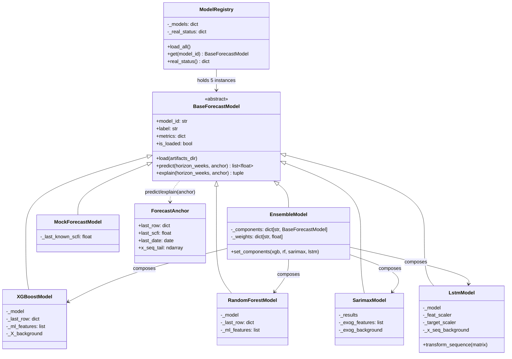

## 19.2 User flow — from landing to viewing a forecast

```mermaid
flowchart TD
    A[Visit /] --> B{Logged in?}
    B -->|No| C[Browse marketing pages<br/>/about /models /pipeline /features]
    C --> D[Click Launch App]
    D --> E[/login]
    B -->|Yes, session exists| F[/app dashboard]
    E --> G{Sign in or Sign up?}
    G -->|Sign in| H[Email/password or Google OAuth]
    G -->|Sign up| I[Create account, email confirmation]
    H --> F
    F --> J[Core Forecast tab:<br/>KPIs + chart + ledger, live rolling data]
    J --> K{User action}
    K -->|Pick model/horizon| L[Instant client-side reshape,<br/>no network call]
    K -->|Click Refresh Forecast| M[POST /run, ~17s, then re-fetch /latest]
    K -->|Switch tab| N[Model Compare / Baselines / SHAP / CV Folds / Features]
```

## 19.3 Sequence diagram — accuracy backfill

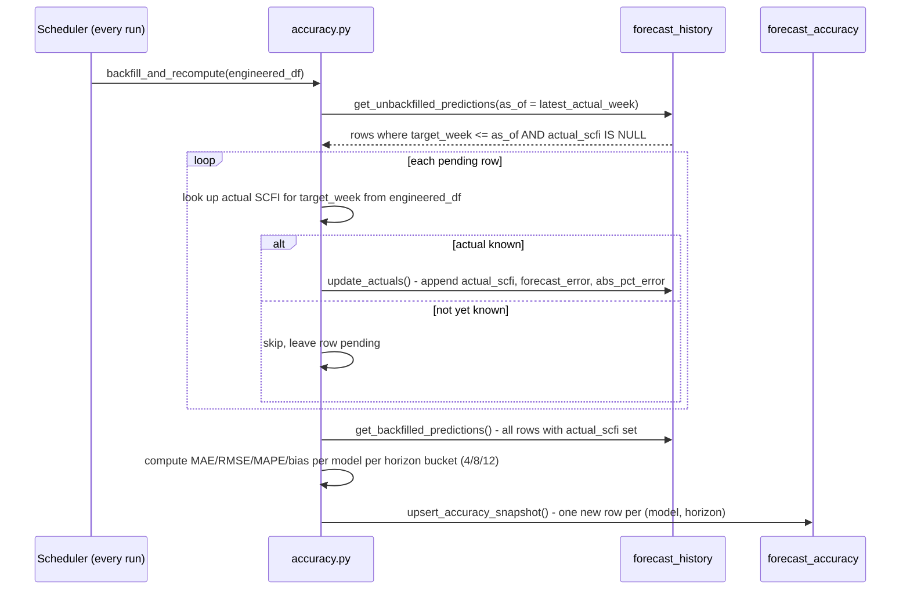

## 19.4 Folder structure (repository root)

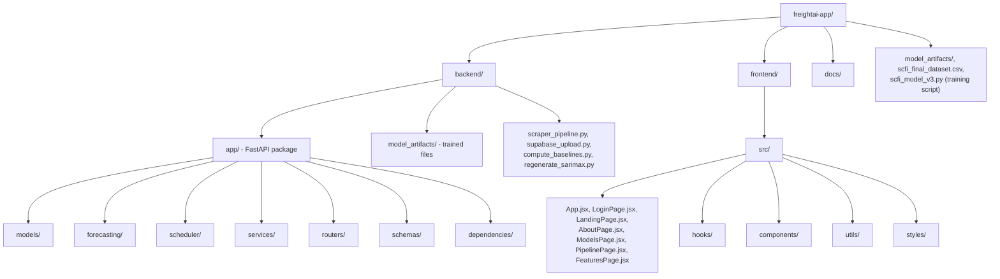

---

# Phase 20: Final Deliverables — Coverage Checklist

This documentation (`docs/PROJECT_DOCUMENTATION.md`, Phases 1–20 complete) covers, with a pointer to where each lives:

| Requested item | Where it's documented |
|---|---|
| Complete architecture | Phase 2 (4 Mermaid diagrams) |
| Every tool/language/framework/library/package | Phase 3 (full tables, backend + frontend + cloud) |
| Every API endpoint | Phase 8 |
| Every database object | Phase 7 (all 4 tables + 1 view, full column specs, ERD) |
| Every pipeline | Phase 5 (data pipeline), Phase 6 (scraper), Phase 11 (forecasting pipeline) |
| Every algorithm | Phase 14 |
| Every mathematical formula | Phase 13 |
| Every forecasting method | Phase 11, Phase 12 |
| Every ML method | Phase 12 |
| Every visualization | Phase 9.4–9.5 (charts/tables), Phase 16 (design) |
| Every workflow | Phases 2, 5, 11, 19 (diagrams) |
| Every design decision (and why) | Phase 4 (patterns/practices), scattered rationale throughout |
| Every important file/folder | Phase 9.1, Phase 10.1, Phase 19.4 |
| Every dependency | Phase 3 |
| Every deployment detail | §1.7–1.8, README cross-referenced |
| Every result the system produces | Phase 17 |
| Security | Phase 15 |
| UI/UX | Phase 16 |
| Report-ready prose (Background/Problem/Objectives/Scope/Discussion/Limitations/Future/Conclusion/References) | Phase 18 |
| Figures | Phases 2, 7.2, 19 |

**Known open items originally flagged during this analysis — all resolved in later sessions (see Phase 17.5 for current status of each):** the degenerate Ensemble weight configuration (fixed — genuine 4-model blend with a 10% floor per model), the RLS gap on the new Supabase tables (enabled, permissively — see 17.5 item 7 for why), the absence of an automated test suite (10 backend + 11 frontend tests added), and git/deployment status (17.5 item 8 — confirmed live on Render + Vercel, not just claimed; see §1.8). **Still genuinely open:** true *scheduled* retraining/confidence intervals remain partial — on-demand retraining and an approximate confidence heuristic now exist (11.9, 11.7), but neither is the fully rigorous/automatic version originally envisioned.

**This documentation is now complete across all 20 phases**, with later revisions (this pass) reflecting the Ensemble fix, the on-demand retraining pipeline, confidence intervals, the scheduler lock, the `scfi_weekly` data-quality fix, and the test suite added after the original 20-phase pass. If you'd like any phase expanded further, cross-checked against a specific file you want re-verified, or reformatted (e.g. exported into a Word document via the docx skill for direct pasting into your report), just ask.
